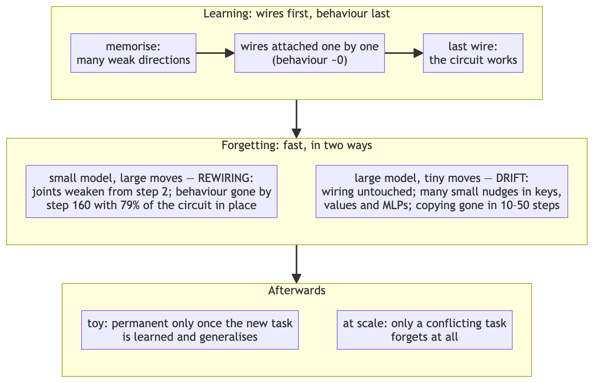
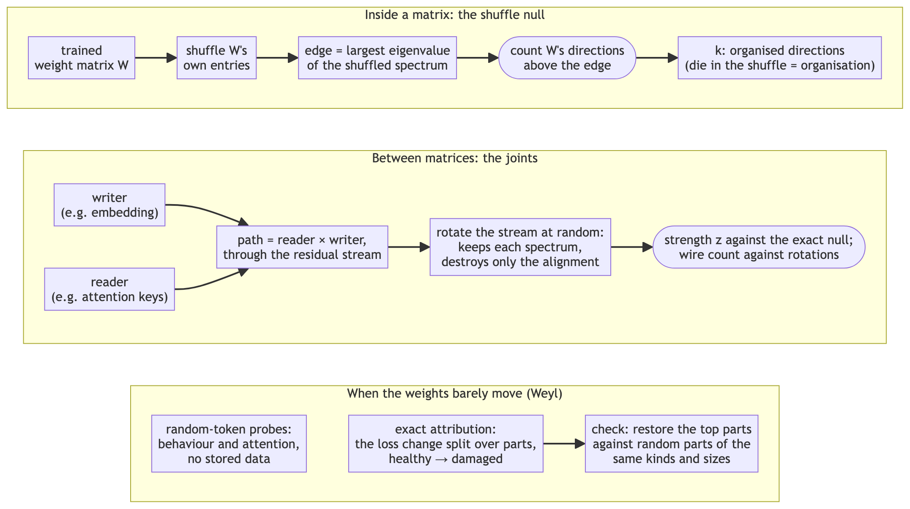
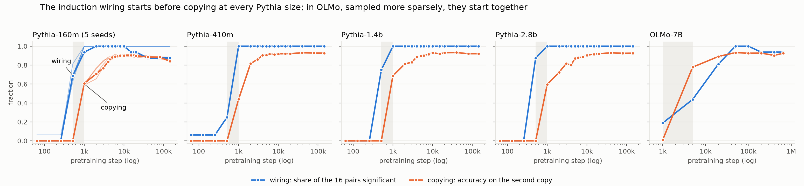
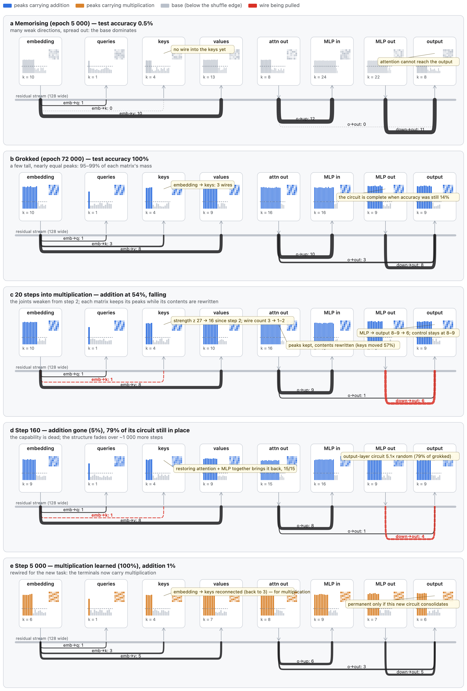

## Abstract

Catastrophic forgetting — a network losing what it knew as soon as it learns something new — is among
the largest obstacles to AI that keeps learning after deployment. Overcoming it needs a detailed account
of what happens inside a network as it forgets. We give one, from the weights and from random-token
probes — no stored data of either task — for two capabilities whose circuits are known: modular addition
in a small grokked transformer, and induction (copying what followed a token's earlier occurrence) in
Pythia, repeated up the Pythia family and in Qwen2.5. In both, grokking and forgetting are two faces of
one coin: the circuit's connections are in place before the behaviour appears, and the behaviour is lost
while most of the circuit is still there.

**Building: structure leads behaviour.** The toy's output-layer circuit is at 7.96× its random level
while test accuracy is 14%. In Pythia's own pretraining the induction wiring — previous-token heads
composing into induction heads' keys — is significant at step 512, while the previous-token heads are
still forming, copying is zero and no induction head attends to its target: in 10–13 of 16 head pairs in
each of five Pythia-160m pretraining seeds, 12 at 1.4b and 14 at 2.8b, but only 4 at 410m. By step 1 000
copying is 0.44–0.69. In OLMo-7B, whose checkpoints are sparser, the wiring and copying begin together.

**Destroying: the behaviour goes first, in two regimes.** In the toy, interference moves the weights
14–88% and *rewires* the circuit: the connections between matrices weaken from the first steps of
interference (10 of 10 seeds), their significant directions are counted out 10–20 steps later, and the
bulk of the circuit fades about 7× more slowly than the function. In Pythia, anti-induction destroys
copying (0.84 → 0.01 in 50 steps on 3 of 3 seeds) while each induction head's weights move under 0.3%
(about 0.05% when copying has halved). At such displacements Weyl's inequality lets no spectral measure
move much, and the wiring cannot show the break: it stays flat even while the model learns a rule that
replaces copying. The loss is *distributed*. An exact path-integral account over the weights (the parts
sum to the loss within 3.8% at 160m and 0.2% in four larger models), which finds damage planted in a
single part (97–105% of the loss on it), spreads it over the network, centred on the induction heads'
layers; per weight, the attention keys, values and outputs carry 1.2–7× their share in all five models
tested (Pythia 160m–1.4b, Qwen2.5 0.5B–1.5B). No small set of parts holds the loss: returning the
top-ranked 4–8% of the weights brings back a third of it at 160m and almost none at 410m and 1.4b
(twenty random sets of the same kinds and sizes, sharing no weight with them: at most 4%), and copying
comes back when about half the weights, chosen by the account, are returned (0.17–0.86). That spread is the optimiser's: trained with SGD to the same
damage, the account puts half the loss in 6–9 parts, mostly attention keys, and returning its top 80
(6% of the weights) brings back three-quarters of it.
On natural text, which the update never trained on, the same damaged models still copy a
repeated passage at 60–92% of their healthy gain.

**At scale, fast forgetting needs conflict.** A new task that contradicts copying (copy-with-offset)
destroys it in all five models tested (13 of 13 runs, to 0.000–0.002: five fine-tuning seeds at
Pythia-160m, two each at 410m, 1.4b, Qwen2.5-0.5B and 1.5B); one that does not (an arithmetic rule
written as text) leaves it at 0.80–0.97, including where the rule is learned to 0.96–0.99. Conflict, not
the inputs, sets the speed: conflicting targets on ordinary text erase copying too, while training on
copying's own random-token inputs without a conflicting target wears it down five times more slowly
than conflict does, and only as general text degrades with it. In the toy every interfering task we tried
destroyed or badly damaged addition, each contradicting it on its own inputs or competing for the same
small block, so the toy cannot say whether conflict is needed; there, the loss becomes hard to undo only
once the new task is learned and generalises.

**The same picture up to 14B.** Up the Pythia family to 2.8b and across Qwen2.5 from 0.5B to 14B, base
and instruct, a conflicting update erases copying within about ten steps (fifty at 160m) while the
induction heads barely move and general-text perplexity barely registers the loss. A companion evaluation of
14 models in six families finds that harmless training leaves every tested skill intact where a conflict
halves it, and that a wiped skill returns after a few correct steps on other items: suppressed, not
deleted.

> **Code, data and the full version.** Everything behind this paper is public at
> [github.com/paragorth/frcs-678](https://github.com/paragorth/frcs-678): the full version with every
> table, the experiments that did not survive, and the provenance of each number
> ([`docs/PAPER_DRAFT.md`](https://github.com/paragorth/frcs-678/blob/main/docs/PAPER_DRAFT.md)); the
> measurement tools ([`tools/`](https://github.com/paragorth/frcs-678/tree/main/tools)); and every result
> file ([`results/live_learning/`](https://github.com/paragorth/frcs-678/tree/main/results/live_learning)).

## 1 Introduction

A model that is trained further loses skills it had (McCloskey and Cohen, 1989; French, 1999). This is
why deployed models are frozen or retrained rather than taught as they go, and it is the central
obstacle to continual learning. The standard remedies — replay, penalties on moving important weights,
separate parameters per task — act without an account of what, in the weights, is lost, where, and
when. A remedy needs to know where to act, and an alarm needs to know what to watch. This paper gives
that account for two capabilities whose circuits are known, followed step by step through learning and
through forgetting: modular addition in a one-layer transformer trained until it groks, and induction —
copying the token that followed an earlier occurrence of the current one — in pretrained language
models.

The starting point is an observation about trained weights: shuffle the entries of a trained weight
matrix, and its histogram — and so its entropy — is unchanged, but the network is dead. Whatever survives
the shuffle is distribution; whatever dies is organisation. Everything here is read that way, without
stored data of either task: from the weights themselves, against shuffle and random-rotation nulls, and
from the model's behaviour on random-token probes. Four findings follow.

**Structure leads behaviour in learning.** The toy's output-layer circuit is complete while the model is
right 14% of the time. In Pythia's own pretraining the induction wiring is significant at step 512, when
no model can copy yet and the previous-token heads are still forming — in five pretraining seeds of
Pythia-160m, at 1.4b and 2.8b, and marginally at 410m; in OLMo-7B, sampled more sparsely, the two begin
together (§4).

**Forgetting has two regimes, and the weights can show only one.** In the toy, interference moves the
weights 14–88% and rewires the circuit: the connections between matrices weaken from the first steps
while each matrix's own structure is unchanged, and the bulk of the circuit fades about 7× more slowly
than the behaviour (§5). At scale, a conflicting fine-tune erases copying while each induction head moves
under 0.3%. By Weyl's inequality no spectral measure can move much at such displacements: the wiring
does not move at all, and a control shows it would not even if the heads were put to another rule
(§6.1). The behaviour still collapses, because the output's change is a sum of many small changes
aligned with the new task (§6). Building a capability is like wiring a circuit; breaking it in a
large model is more like a mixing desk on which no cable is pulled but dozens of faders are each nudged
down a little: the wiring is intact and the signal is gone.

**At scale, under Adam, the loss is distributed, and no small set of parts holds it.** An exact path-integral account
over the weights, in five models of two families, spreads the rise in copy loss thinly over the network,
centred on the circuit's own layers. It finds damage planted in one part, and it ranks well — at 160m its
top parts return ten times the loss that random ones do — but returning even its top-ranked 4–8% of the
weights brings back little of the loss. The spread is the optimiser's: under SGD the same damage sits in
a few attention keys, and returning 6% of the weights brings back three-quarters of it (§6.2–6.3).

**At scale, fast forgetting needs conflict.** A new task that contradicts copying destroys it in all
five models; one that does not leaves it intact, even when it is learned almost perfectly; training on
copying's own inputs without conflict wears it down only slowly, along with everything else; and the
damaged models still copy natural text (§6.4–6.5).

{width=78%}

**Figure 1.** The timeline in one picture. Learning attaches the circuit's wires before the behaviour
appears. Forgetting is fast in both regimes: a small model is rewired, with most of the circuit still in
place when the behaviour is gone; in a large model the wiring is untouched and the loss is spread over
many small changes. What happens afterwards depends on the new task.

## 2 Related work

*Where forgetting happens.* Ramasesh et al. (2021) locate forgetting in the higher layers of image
classifiers; in induction forgetting we find it centred on the circuit's own layers, with the top layer
carrying under 1%. *Forgetting as lost alignment or access* — spurious forgetting (Zheng et al., 2025),
*Diagnosing Catastrophe* (Anthes et al., 2023) — is argued from activations, probes and brief retraining; we locate the
loss in the weights and time it; Yang et al. (2026) find the parameters whose updates cause forgetting to
be 50–75% of all. *Forgetting without conflict:* benign fine-tuning can erode safety behaviour through the
curvature of the loss (Springer et al., 2026), and a more annealed, sharper model forgets more under
fine-tuning (Rofin et al., 2026). *Connections between components:* composition scores (Elhage et al.,
2021), low-rank channels from weight SVDs (Merullo et al., 2024), an exact Haar-rotation null scoring
each writer–reader pair (Wang, 2026) and singular-vector alignment through training (Yunis et al., 2024); ours is the
dynamics, through building and forgetting. *Induction heads* form in a phase change early in training
(Olsson et al., 2022), and in Pythia's checkpoints their K-composition arrives within the same window as
the behaviour by a measure without a null (Li, 2026); Pythia's public checkpoints (Biderman et al., 2023) and the extra pretraining seeds
of PolyPythias (van der Wal et al., 2025) let us time the wiring against the behaviour. *Attribution:*
integrated gradients (Sundararajan et al., 2017), loss change allocation over a training run (Lan et al.,
2019), attribution patching (Nanda, 2023; Syed et al., 2024) and skill
grafting (Panigrahi et al., 2023); we integrate over the weights, from the healthy to the damaged model,
and test the ranking against planted damage and by restoring parts against random ones that share no
weight with them. *Suppression rather than
deletion:* fine-tuned-away skills often return, after brief retraining (Jain et al., 2024) or under translated prompts (Kotha et al., 2024), which our
distributed regime fits. *Same-format interference:* new facts in a familiar template damage known ones
(Gekhman et al., 2024; Kaplan et al., 2026). *Perturbation bounds:* Weyl (1912) for singular values;
Wedin (1972), the singular-vector form of Davis and Kahan (1970), for singular subspaces.
The full comparison table is in the full version.

## 3 Method

**Structure inside a matrix.** For a weight matrix W we count the directions whose singular values exceed
the largest found when W's own entries are shuffled (k): structure that permutation destroys (Martin and
Mahoney, 2021; Prakash and Martin, 2025, 2026). The count is stable to the null's two constants (±2 directions over
their swept ranges).

**Connections between matrices.** A writer W (embedding, attention output, MLP output) and a reader R
(queries, keys, values, MLP input, unembedding) meet in the residual stream. Their composition score
C = ‖RW‖_F / (‖R‖_F ‖W‖_F) (Elhage et al., 2021) is compared with its exact null under a Haar-random
rotation of the stream, which keeps both matrices' spectra and destroys only their alignment:
E[C²] = 1/d, with closed-form variance (Wang, 2026). A joint's **strength** is z = (C² − E[C²]) / sd,
tested with Benjamini–Hochberg correction (Benjamini and Hochberg, 1995); its **wire count** is the number of singular values of RW
above the largest under sampled rotations. At scale, **the wiring** is the K-composition from the four
strongest previous-token heads into the four strongest induction heads' keys (16 pairs), with the heads
identified in the final model.

**What the weights can show.** For any change ΔW, |σᵢ(W + ΔW) − σᵢ(W)| ≤ ‖ΔW‖₂ ≤ ‖ΔW‖_F (Weyl, 1912), and
singular directions turn by at most about ‖ΔW‖₂ divided by the spectral gap (Wedin, 1972). We report the
displacement ‖W_t − W₀‖_F / ‖W₀‖_F. At the 0.1–1% displacements of fine-tuning every statistic above
can move only a little; the output has no such bound, since its change is a sum over every parameter of
gradient × change.

**Probes.** 64 random-token sequences of 40 tokens, each shown twice; **copying** is next-token accuracy
on the second copy; head scores are attention to the induction target and to the previous token, and
the attention to the first position (the sink). A natural-text check reads an averaged form of the
in-context learning score of Olsson et al. (2022), who take the loss at token 500 minus that at token 50
(we average tokens 400–510 and 40–63 of 512-token wikitext-2 windows; Merity et al., 2017), and copying
of repeated wikitext-2 passages.

**Exact attribution and restore.** Along the straight path from the healthy weights θ₀ to the damaged
θ₁, L(θ₁) − L(θ₀) = ∫₀¹ ∇L(θ(α)) · (θ₁ − θ₀) dα exactly. Splitting the dot product by parts — each
head's queries, keys, values and output columns; each layer's MLP input and output; norms; embeddings —
gives each part's share (midpoint quadrature, K = 16; the residual is reported). The causal check
returns the N top-ranked parts to their healthy values in the damaged model and compares with random
parts of the same kinds and sizes; a stricter version splits each MLP matrix into 16 groups of neurons,
scores on fresh probes, and draws twenty random sets that share no weight with the top set. A positive
control trains one part alone until copying is gone and asks whether the account finds it.

**Models and training.** *Toy:* a one-layer transformer (d = 128, four heads) on arithmetic mod 113,
full-batch AdamW (Loshchilov and Hutter, 2019; learning rate 1e-3, weight decay 1.0), following Nanda et
al. (2023); addition on 30% of pairs is grokked (Power et al., 2022), then an
interfering task on the same inputs — multiplication (25% of pairs) unless stated — is trained alone.
*At scale:* Pythia 160m–2.8b (Biderman et al., 2023) and Qwen2.5 0.5B–14B (Qwen Team, 2024; instruct and
base), full fine-tuning in float32 at
3e-6 with batch 8 — never LoRA (Hu et al., 2022), which would constrain the very update being measured. Interfering tasks:
**anti-induction** (each copied target replaced by a fixed permutation of it), **copy-with-offset**
(predict the token two after the earlier occurrence), an **arithmetic rule** written as text (no
conflict with copying), and wikitext as a harmless control. Controls for conflict: the same random-token
inputs trained without a conflicting target (a fixed map of each token, or next-token prediction on the
unrepeated half), anti-induction targets on repeated wikitext, and anti-induction targets mixed with
correct ones at 10–50%. *Pretraining checkpoints:* Pythia's public
checkpoints at 18 steps for four sizes, four extra pretraining seeds of Pythia-160m (PolyPythias; van der
Wal et al., 2025), and the nine snapshots of OLMo-7B-0724 (Groeneveld et al., 2024).¹

**Figure 2.** The measures. Inside a matrix, the shuffle null counts organised directions; between
matrices, a random rotation of the shared stream calibrates each connection; when the weights barely
move, random-token probes and an exact attribution read the loss instead.

¹ On the Hugging Face hub, Pythia-2.8b's revisions for steps 0–80 000 list the final model's single-file
weights; only their sharded files (and the `.bin` of 40 000 and 80 000) differ per step, so a default
load of an early revision returns the finished model. We use the file unique to each revision.

## 4 Learning: the wiring comes first

In the toy, trained on addition from scratch, the training set is memorised by epoch 1 000 and test
accuracy stays near zero until about epoch 35 000:

| epoch | 20 000 | 30 000 | **35 000** | 40 000 |
|---|---|---|---|---|
| test accuracy | 0.009 | 0.034 | **0.140** | 1.000 |
| output-layer Fourier concentration (× random) | 2.56 | 6.63 | **7.96** | 6.10 |

The output layer's circuit is complete while the model is right 14% of the time; in matrix terms the
transition goes from many weak directions to a few strong ones (Figure 4, panels a–b).

At scale, in each model's own pretraining:

| run | step 512: copying | step 512: wiring pairs significant | step 1 000: copying |
|---|---|---|---|
| Pythia-160m, five pretraining seeds | 0.000 | 10–13 of 16 | 0.59–0.61 |
| Pythia-410m | 0.000 | 4 of 16 | 0.44 |
| Pythia-1.4b | 0.000 | 12 of 16 | 0.69 |
| Pythia-2.8b | 0.000 | 14 of 16 | 0.60 |

In every Pythia run the wiring is significant at step 512 while copying is exactly zero and no
induction head yet attends to its target (best score 0.02–0.05, against 0.85–0.96 at step 1 000). The
previous-token heads, by contrast, are forming then (score 0.36–0.56, from 0.03–0.12 at step 256), so the
wiring leads the induction heads and copying, not the whole circuit; Li (2026), reading the same
checkpoints without a null, sees the K-composition arrive within the same window as the behaviour. The
lead is bounded by the checkpoint spacing — none exist between steps 512 and 1 000 — and at 410m it is
marginal. Copying is read as top-1 accuracy, which can stay at zero while the behaviour is already
building; a continuous reading of these steps is still to do. In OLMo-7B the onsets coincide: at step
1 000 (4B tokens) 3 of 16 pairs are significant, copying is 0.010 and the strongest induction head
already attends 11× above uniform; by step 5 000 copying is 0.78 with 7 of 16, and the wiring on the final
model's heads completes only by step 50 000. The weights then settle: movement per step falls
37–71-fold from the phase change to the end of training.

**Figure 3.** The induction wiring starts before copying at every Pythia size; in OLMo, sampled more
sparsely, the two start together. Copying
(orange) and the share of the 16 previous-token → induction-key pairs that are significant (blue),
through each model's own pretraining; the five Pythia-160m pretraining seeds are overlaid, the original
in bold. Grey: the interval in which copying appears and no checkpoint exists.

## 5 Forgetting in a small model: rewiring

Every interfering task we tried destroyed or badly damaged addition, and every one was posed on
addition's own inputs or competed for the same small block. Under multiplication (10 seeds; a control
keeps training addition, 3 seeds):

| step | 0 | 2 | 3 | 10 | 20 | 160 |
|---|---|---|---|---|---|---|
| addition | 1.00 | 0.99 | 0.84 | 0.87 | 0.54 | 0.05 |
| embedding → keys strength z | 27.2 | 25.2 | 24.3 | 18.5 | 16.3 | 22.6 |
| its wire count | 3 | 3 | 3 | 3 | 1.5 | 1 |
| control strength z | 27.2 | 27.0 | 26.9 | 26.2 | 26.0 | 29.3 |

The connection's strength is more than 5% below its start at step 2 in 10 of 10 seeds, one step before
accuracy first falls below 0.90; the control stays within 5% until step 10. The discrete wire count lags
10–20 steps. Each matrix keeps its own count of organised directions while its contents are rewritten
(the keys move 57% by step 20). The circuit fades about 7× more slowly than the behaviour: 79% of the
output-layer circuit is still present at step 160, with addition at 0.05, and it takes about 1 000 more
steps to fall to the level of memorisation.

Whether the loss lasts is a separate, later event. In 31 of 32 runs, four events come in order:
addition is destroyed (by ~200 steps) while each matrix's organised directions are unchanged;
multiplication is learned (~1 900–4 600); the old directions collapse (~4 400–5 600); and only then does
the loss become hard to undo. In all 8 runs where multiplication failed to generalise, addition came
back. Repair needs a set of parts: restoring attention and MLP together recovers in 15 of 15 runs,
single parts erratically, and the two ends of the first connections to weaken — the keys and the MLP
output — no better than restoring nothing.

{width=84%}

**Figure 4.** One circuit, built wire by wire and broken fast (toy, addition then multiplication; seed
means). Each node is a weight matrix — its spectrum, with peaks above the shuffle edge (organised
directions) and the base below — and wires run through the shared residual stream, their thickness the
wire count. (a) Memorising: many weak directions. (b) Grokked: a few tall, nearly equal peaks. (c) 20
steps into multiplication: the joints have weakened since step 2 while each matrix keeps its peaks.
(d) Step 160: addition gone, 79% of its circuit still in place. (e) Step 5 000: rewired, the same
terminals now carrying multiplication.

## 6 Forgetting at scale: distributed drift

### 6.1 Copying goes, the wiring does not move

Anti-induction at 3e-6 takes Pythia-160m's copying from 0.84 to 0.01 in 50 steps (three fine-tuning
seeds: 0.28 / 0.25 / 0.26 at step 10, 0.010 / 0.009 / 0.006 at step 50) with the wiring at z = 115.9 at
every mark. The same happens at every size, in both families:

| model | copying, step 0 | step 5 | step 10 | wiring z (unchanged) | perplexity, step 0 → 10 |
|---|---|---|---|---|---|
| Pythia-160m | 0.841 | 0.60 | 0.25–0.28 | 115.9 | 88 → 91 |
| Pythia-410m | 0.927 | 0.306 | 0.025 | 186.4 | 74.0 → 80.3 |
| Pythia-1.4b | 0.921 | 0.095 | 0.009 | 349.2 | 60.4 → 60.7 |
| Pythia-2.8b | 0.927 | 0.069 | 0.008 | 364.0 | 52.1 → 50.9 |
| Qwen2.5-0.5B-Instruct | 0.936 | 0.531 | 0.023 | 73.7 | 84.1 → 81.1 |
| Qwen2.5-1.5B-Instruct | 0.948 | 0.767 | 0.034 | 63.2 | 101.6 → 95.3 |
| Qwen2.5-3B-Instruct | 0.943 | 0.625 | 0.029 | 238.3 | 105.3 → 98.7 |
| Qwen2.5-7B-Instruct | 0.948 | 0.528 | 0.005 | 372.5 | 58.7 → 53.4 |
| Qwen2.5-7B (base) | 0.949 | 0.551 | 0.002 | 372.7 | 18.4 → 19.3 |
| Qwen2.5-14B-Instruct | 0.938 | 0.050 | 0.000 | 613.7 | 55.2 → 52.4 |
| Qwen2.5-14B (base) | 0.949 | 0.039 | 0.000 | 613.7 | 16.1 → 13.1 |

Each induction head's keys move about 0.05% when copying has halved and under 0.3% by step 50; a
wikitext control at the same rate leaves copying intact. The wiring's stillness shows the limit of the
measure more than the state of the circuit: under copy-with-offset, which puts the same heads to another
rule (learned to 0.92 at 160m and 0.99 at 410m, copying to 0.004 and 0.001), it holds its starting value
to the first decimal, and it falls only at displacements a hundred times larger (wikitext at 1e-3: the
keys move 60–240% and z falls from 116 to 22–44, after the model first collapses). General-text
perplexity barely registers the loss over the first ten steps — in the Qwen instruct models it improves
while copying dies — though it rises later (×1.4–1.5 by step 50 at 160m). The induction heads' attention slides
to the attention sink, but restoring their queries and keys returns copying only to 0.014: a symptom,
not the seat. And each model breaks at its own displacement of those keys, which the learning rate
barely changes (the full version gives it at every size).

### 6.2 An exact account of the loss

The path integral attributes the rise in copy loss (50 damaging steps) to the parts, in five models.
Per-weight blame is a kind's share of the rise divided by its share of the attention and MLP weights:

| model | residual | queries | keys | values | attention out | MLP in | MLP out | largest part |
|---|---|---|---|---|---|---|---|---|
| Pythia-160m (3 seeds) | +1.6 to +3.8% | 0.37 | **4.1** | 2.1–2.2 | 1.2–1.3 | 0.49 | 0.65–0.70 | 5.8–6.8% |
| Pythia-410m | +0.1% | 0.67 | **2.6** | 1.8 | 1.3 | 0.49 | 0.91 | 2.9% |
| Pythia-1.4b | +0.2% | 0.80 | 1.3 | **2.1** | 1.8 | 0.48 | 1.05 | 4.0% |
| Qwen2.5-0.5B | 0.0% | 1.2 | 3.7 | **7.1** | 3.0 | 0.71 | 0.97 | 3.7% |
| Qwen2.5-1.5B | 0.0% | 1.5 | 4.3 | **6.3** | 3.4 | 0.69 | 0.90 | 3.3% |

The account closes. No single part carries more than 7%; the loss centres on the induction heads' layers
and is near zero in the first and last. Per weight, keys, values and attention outputs carry more than
their size in every model, while the MLP inputs carry about half theirs.

Three checks support the account. Damage planted in a single part — an MLP output, an attention block's
queries, keys and values, or an attention output, trained alone at 1e-4 until copying is gone — is found
there: 97–105% of the attributed loss falls on the planted part, and returning the account's top 40 parts
repairs copying (0.78–0.85, healthy 0.85) where twenty random sets of the same kinds and sizes repair
nothing. The ranking does not hinge on the loss read: with the loss on correctly copied tokens only, or
the logit margin, the parts' ranks agree with the full loss's at ρ 0.89–0.94 (nine of the top ten
shared), as they do across fine-tuning seeds (0.95–0.96) and at 8 or 20 damaging steps instead of 50
(0.86–0.91). The spread, though, belongs to the optimiser. Trained instead with SGD (momentum 0.9) to the same
damage — copying 0.02 and perplexity ×1.6–1.7, against Adam's 0.01 and ×1.4–1.5 — the account puts half the loss
in 6–9 of the 1 480 parts rather than 92–107, three-quarters of it on attention keys, and shares only
four or five of Adam's top ten. Adam moves every weight by a similar step whatever its gradient; SGD
moves the weights the gradient points at. (Run on to 300 steps, SGD wrecks the whole model — perplexity
×106–478 — and its account is not comparable.)

### 6.3 No small set of parts holds the loss

Parts returned to their healthy values in the damaged model, first as whole parts (share of the
attention and MLP weights in brackets):

| | Pythia-160m (3 seeds) | 410m | 1.4b | Qwen 0.5B | Qwen 1.5B |
|---|---|---|---|---|---|
| healthy → damaged | 0.84 → 0.01 | 0.93 → 0.00 | 0.92 → 0.00 | 0.94 → 0.00 | 0.95 → 0.00 |
| best single kind, in full | ≤ 0.07 | 0.00 | 0.00 | 0.00 | 0.00 |
| top 80 parts by attribution | **0.62–0.66** (62–64%) | **0.37** (60%) | **0.17** (52%) | **0.78** (61%) | **0.86** (57%) |
| 80 random parts, same kinds and sizes | 0.17–0.30 | ≤ 0.006 | 0.002 | ≤ 0.008 | 0.002 |

Whole parts are coarse: at 160m the top 80 are 8% of the parts but 64% of the weights, and a random set
that large must share most of its weights with them (56% at 160m). The stricter test splits each MLP
matrix into 16 groups of neurons (1 480 parts at 160m, 3 628 at 410m and 1.4b), scores on fresh probes,
and draws twenty random sets of the same kinds and sizes that share no weight with the top set:

| | Pythia-160m (3 seeds) | 410m | 1.4b |
|---|---|---|---|
| healthy → damaged (fresh probes) | 0.85 → 0.01 | 0.93 → 0.00 | 0.93 → 0.00 |
| top 80 parts: copying (share of the copy loss returned) | 0.095–0.115 (32–36%) | 0.001 (3%) | 0.000 (1%) |
| their share of the weights | 7.3–8.0% | 3.9% | 5.1% |
| 20 disjoint random sets, same kinds and sizes | ≤ 0.02 (≤ 4%) | 0.000 (≤ 1%) | 0.000 (0%) |
| 50 random subsets, up to 15% / 5% / 5% of the weights | ≤ 13% of the loss | ≤ 1% | 0% |

Under Adam the account ranks well — at 160m its top parts return ten times the loss that disjoint random
parts do — but no small set of parts brings copying back: the loss is spread too widely. Copying returns
when about half the weights, chosen by the account, are returned (0.17–0.86 above), and after a few
correct training steps (Garg, 2026). Under SGD at the same damage the same test finds the loss
concentrated: the top 10 parts (0.6% of the weights) bring back 36–39% of it, the top 40 (2.7%) 60–61%, and
the top 80 (6%) 74–76% (copying 0.34–0.65), where disjoint random sets bring back none (≤ 3%). No single
kind repairs the loss; in the toy a set does, and at scale a large one after Adam, a small one after
SGD.

### 6.4 Forgetting needs conflict

| model (fine-tuning seeds) | copy-with-offset: copying after | arithmetic rule: rule learned → copying after |
|---|---|---|
| Pythia-160m (5) | 0.000–0.002 | 0.47–0.55 → 0.80–0.88 |
| Pythia-410m (2) | 0.001 | 0.58–0.76 → 0.92–0.93 |
| Pythia-1.4b (2) | 0.000 | 0.96–0.99 → 0.93–0.94 |
| Qwen2.5-0.5B (2) | 0.000–0.001 | 0.87 → 0.96 |
| Qwen2.5-1.5B (2) | 0.000 | 0.96–0.99 → 0.97 |

Copy-with-offset, learned to 0.93–1.00 everywhere, takes copying to zero in 13 of 13 runs; the rule leaves
it intact in 13 of 13, including where it is learned almost perfectly. Under offset the same parts carry
the old skill's loss and the new task's gain (at 160m the same three keys in all five seeds). The harmless
wikitext control erodes copying only slowly (0.84 → 0.74 after 150 steps). Controls separate the
conflict from the inputs (Pythia-160m, two seeds each, 100 steps at 3e-6; copying halves at the step
shown, with general-text perplexity relative to its start):

| update | copying halves by step | perplexity then | copying after 100 steps |
|---|---|---|---|
| anti-induction (conflict on copying's own inputs) | 8–10 | ×1.02–1.04 | 0.01 by step 50 |
| anti-induction targets on repeated wikitext (conflict, other inputs) | 20 | ×3.4 | 0.007–0.012 |
| the same random-token inputs, a fixed map of each token (no conflict) | 50 | ×1.9–2.3 | 0.12–0.13 |
| the same inputs, next-token prediction on the unrepeated half (no conflict) | 50 | ×2.3–2.4 | 0.10–0.13 |
| anti-induction targets mixed with correct ones, 10% / 25% / 50% | never | — | 0.92–0.93 / 0.81 / 0.71–0.72 |

At 410m the same holds (anti-induction: half by step 5 at ×1.02; the fixed map: by step 30 at ×6.9).
Conflict erases copying fast and while general text barely moves; without it, training on the same
inputs wears copying down five times more slowly and only as the whole model degrades; and the map
learned without conflict is never applied to the second copy (0.000), so this is not conflict arriving by
generalisation. "Conflict" is still defined by construction here, and the toy cannot test whether it is needed, since every task we tried there
destroyed addition. In a companion stream of synthetic skills (Garg, 2026), training a new skill in an old skill's
prompt frame damages the old one too; whether that is conflict arriving by generalisation is still being tested.

### 6.5 On natural text the loss is partial

The damaged models of §6.2, read on wikitext, which the damaging update never saw:

| model | random-token copying, damaged | natural-text copying, second copy: healthy → damaged | gain kept | in-context learning score: healthy → damaged |
|---|---|---|---|---|
| Pythia-160m, 3 seeds | 0.006–0.009 | 0.930 → 0.646–0.682 | 63–68% | −0.97 → −1.06 to −1.14 |
| Pythia-410m | 0.000 | 0.941 → 0.668 | 64% | −0.93 → −0.53 |
| Pythia-1.4b | 0.000 | 0.939 → 0.657 | 60% | −0.97 → −1.29 |
| Qwen2.5-0.5B | 0.000 | 0.950 → 0.804 | 79% | −0.72 → −0.78 |
| Qwen2.5-1.5B | 0.000 | 0.955 → 0.897 | 92% | −0.79 → −0.78 |

Copying a repeated passage keeps 60–92% of its gain over the first copy, and the in-context learning
score is unchanged or stronger in six of seven (the exception, Pythia-410m, is also where 50 steps
nearly triple general-text perplexity). Copying is gone on the kind of input the update trained on and
only partly lost elsewhere — the pattern of suppression rather than deletion.

## 7 Discussion: one circuit picture, two regimes

**What is common.** In both regimes structure leads behaviour in learning; the behaviour dies while most
of the circuit is still in place; the attention side that decides where heads look and what they carry
takes more of the loss than its size; and no single part repairs the loss — in the toy a set does, and
at scale a large one after Adam, a small one after SGD. Grokking and
forgetting are two faces of the same coin because building needs every connection, while destroying
needs only that the circuit's output be redirected.

**What differs is how far the weights must move.** A skill halves when about 60% of the toy's keys have
moved, and when about 0.06% of Pythia's induction keys have — a thousandfold apart. This is mostly a
property of the model, not of the learning rate: over a 100-fold range of rates the toy forgets at the
same displacement, and Pythia-160m at rates 10–33× higher is destroyed within two steps with its wiring
unchanged. Two cautions: under Adam a step's size is set by the learning rate rather than the gradient,
so a breaking displacement that ignores the rate is partly the optimiser's doing; and we read it on the
keys, which time the damage but are not its seat. Weyl then decides what the weights can show: at the toy's displacement every spectral measure
can move; at Pythia's none can move much.

**What it means for intervening.** In the rewiring regime a weights-only alarm is possible, because the
connections move with the behaviour. At scale an alarm has to read behaviour, and random-token probes do
so without stored data. After an Adam update repair cannot target a few parts — even the top-ranked
4–8% of the weights return little — while after SGD 6% of the weights return three-quarters of the loss:
how a model is updated decides where its forgetting sits. A few correct training steps return the skill
— the mark of suppression rather than deletion.

## 8 Limitations

One toy architecture (a one-layer transformer) and one circuit at scale, measured on random-token
copying. The attribution is computed at one dose (50 steps at 3e-6; at 8 and 20 steps it ranks the
parts alike), on three fine-tuning seeds at 160m and one elsewhere. The spread is Adam's: under SGD the same damage concentrates (§6.2–6.3), which we
test at 160m only. The conflict result rests
on two to five fine-tuning seeds per cell in five models, "conflict" is defined by construction, and it
holds for small displacements and a skill that is not a safety behaviour; benign fine-tuning can erode
safety through curvature alone (Springer et al., 2026). The pretraining lead is bounded by the
checkpoint spacing, is read with top-1 accuracy, is not yet tested against every earlier → later head
pair, and at 410m it is marginal. The comparison of the two regimes rules out the learning rate as their cause, but not size or
the other differences between a one-layer toy and a pretrained family. The Haar null is loose for trained
matrices (Wang, 2026, finds 47% of GPT-2's head pairs above it at z ≥ 2), and our p-values use a normal
approximation to its tail; we use it only for head pairs fixed in advance, against their own values at
step 0 and a control path (embedding → induction keys) whose z is at most 2.3 in all but one Pythia run
(3.1 in one 160m seed) and 3.1 in OLMo, while the wiring's mean z in the final models is 89–364.

## 9 Conclusion

A capability in a transformer is built ahead of its behaviour and lost fast, and the weights record both
— in two different ways. In learning, the circuit's wiring is in place before the behaviour appears. In
forgetting, the behaviour goes first: a small network is rewired, and the connections between its
matrices show the break as it happens; in a large one the update is a thousandth the size, no spectral
measure can move much, and under Adam the loss is spread thinly over many parts — too thinly for any
small set of them, however well ranked, to bring the skill back — while under SGD it sits in a few
attention keys; a few correct steps bring it back. At scale, fast
forgetting needed a target that contradicts the skill; without one the skill wore down slowly, along
with everything else. All of
it is read from the weights and from random-token probes, with no stored data.

*Full version, tools and results: [github.com/paragorth/frcs-678](https://github.com/paragorth/frcs-678).*

## References

Anthes, D., Thorat, S., König, P. and Kietzmann, T. C. (2023). Diagnosing catastrophe: large parts of accuracy loss in continual learning can be accounted for by readout misalignment. *Conference on Cognitive Computational Neuroscience (CCN 2023)*. [doi:10.32470/CCN.2023.1256-0](https://doi.org/10.32470/CCN.2023.1256-0); [arXiv:2310.05644](https://arxiv.org/abs/2310.05644)

Benjamini, Y. and Hochberg, Y. (1995). Controlling the false discovery rate: a practical and powerful approach to multiple testing. *Journal of the Royal Statistical Society: Series B (Methodological)* 57(1), 289–300. [doi:10.1111/j.2517-6161.1995.tb02031.x](https://doi.org/10.1111/j.2517-6161.1995.tb02031.x)

Biderman, S., Schoelkopf, H., Anthony, Q., et al. (2023). Pythia: a suite for analyzing large language models across training and scaling. *ICML 2023*, PMLR 202, 2397–2430. [arXiv:2304.01373](https://arxiv.org/abs/2304.01373)

Davis, C. and Kahan, W. M. (1970). The rotation of eigenvectors by a perturbation. III. *SIAM Journal on Numerical Analysis* 7(1), 1–46. [doi:10.1137/0707001](https://doi.org/10.1137/0707001)

Elhage, N., Nanda, N., Olsson, C., et al. (2021). A mathematical framework for transformer circuits. *Transformer Circuits Thread*. <https://transformer-circuits.pub/2021/framework/index.html>

French, R. M. (1999). Catastrophic forgetting in connectionist networks. *Trends in Cognitive Sciences* 3(4), 128–135. [doi:10.1016/S1364-6613(99)01294-2](https://doi.org/10.1016/S1364-6613(99)01294-2)

Garg, P. (2026). Fine-tuning fragility: an eval of how much fine-tuning a model's skills can take. In preparation.

Gekhman, Z., Yona, G., Aharoni, R., Eyal, M., Feder, A., Reichart, R. and Herzig, J. (2024). Does fine-tuning LLMs on new knowledge encourage hallucinations? *EMNLP 2024*, 7765–7784. [doi:10.18653/v1/2024.emnlp-main.444](https://doi.org/10.18653/v1/2024.emnlp-main.444)

Groeneveld, D., Beltagy, I., Walsh, E., et al. (2024). OLMo: accelerating the science of language models. *ACL 2024 (Volume 1: Long Papers)*, 15789–15809. [doi:10.18653/v1/2024.acl-long.841](https://doi.org/10.18653/v1/2024.acl-long.841)

Hu, E. J., Shen, Y., Wallis, P., et al. (2022). LoRA: low-rank adaptation of large language models. *ICLR 2022*. [arXiv:2106.09685](https://arxiv.org/abs/2106.09685)

Jain, S., Kirk, R., Lubana, E. S., et al. (2024). Mechanistically analyzing the effects of fine-tuning on procedurally defined tasks. *ICLR 2024*. [arXiv:2311.12786](https://arxiv.org/abs/2311.12786)

Kaplan, G., Gekhman, Z., Zhu, Z., et al. (2026). Why fine-tuning encourages hallucinations and how to fix it. *COLM 2026*. [arXiv:2604.15574](https://arxiv.org/abs/2604.15574)

Kotha, S., Springer, J. M. and Raghunathan, A. (2024). Understanding catastrophic forgetting in language models via implicit inference. *ICLR 2024*. [arXiv:2309.10105](https://arxiv.org/abs/2309.10105)

Lan, J., Liu, R., Zhou, H. and Yosinski, J. (2019). LCA: loss change allocation for neural network training. *NeurIPS 2019*. [arXiv:1909.01440](https://arxiv.org/abs/1909.01440)

Li, H. (2026). Fingerprint, not blueprint: how positional schemes set the default spectral algebra of attention. [arXiv:2607.06621](https://arxiv.org/abs/2607.06621)

Loshchilov, I. and Hutter, F. (2019). Decoupled weight decay regularization. *ICLR 2019*. [arXiv:1711.05101](https://arxiv.org/abs/1711.05101)

Martin, C. H. and Mahoney, M. W. (2021). Implicit self-regularization in deep neural networks: evidence from random matrix theory and implications for learning. *Journal of Machine Learning Research* 22(165), 1–73. [arXiv:1810.01075](https://arxiv.org/abs/1810.01075)

McCloskey, M. and Cohen, N. J. (1989). Catastrophic interference in connectionist networks: the sequential learning problem. In G. H. Bower (ed.), *Psychology of Learning and Motivation*, vol. 24, 109–165. Academic Press. [doi:10.1016/S0079-7421(08)60536-8](https://doi.org/10.1016/S0079-7421(08)60536-8)

Merity, S., Xiong, C., Bradbury, J. and Socher, R. (2017). Pointer sentinel mixture models. *ICLR 2017*. [arXiv:1609.07843](https://arxiv.org/abs/1609.07843)

Merullo, J., Eickhoff, C. and Pavlick, E. (2024). Talking heads: understanding inter-layer communication in transformer language models. *NeurIPS 2024*, 61372–61418. [arXiv:2406.09519](https://arxiv.org/abs/2406.09519)

Nanda, N. (2023). Attribution patching: activation patching at industrial scale. Blog post. <https://www.neelnanda.io/mechanistic-interpretability/attribution-patching>

Nanda, N., Chan, L., Lieberum, T., Smith, J. and Steinhardt, J. (2023). Progress measures for grokking via mechanistic interpretability. *ICLR 2023*. [arXiv:2301.05217](https://arxiv.org/abs/2301.05217)

Olsson, C., Elhage, N., Nanda, N., et al. (2022). In-context learning and induction heads. *Transformer Circuits Thread*. [arXiv:2209.11895](https://arxiv.org/abs/2209.11895)

Panigrahi, A., Saunshi, N., Zhao, H. and Arora, S. (2023). Task-specific skill localization in fine-tuned language models. *ICML 2023*, PMLR 202, 27011–27033. [arXiv:2302.06600](https://arxiv.org/abs/2302.06600)

Power, A., Burda, Y., Edwards, H., Babuschkin, I. and Misra, V. (2022). Grokking: generalization beyond overfitting on small algorithmic datasets. [arXiv:2201.02177](https://arxiv.org/abs/2201.02177)

Prakash, H. K. and Martin, C. H. (2025). Grokking and generalization collapse: insights from HTSR theory. [arXiv:2506.04434](https://arxiv.org/abs/2506.04434)

Prakash, H. K. and Martin, C. H. (2026). Detecting overfitting in neural networks during long-horizon grokking using random matrix theory. *ICML 2026 Workshop on High Dimensional Learning Dynamics*. [arXiv:2605.12394](https://arxiv.org/abs/2605.12394)

Qwen Team (2024). Qwen2.5 technical report. [arXiv:2412.15115](https://arxiv.org/abs/2412.15115)

Ramasesh, V. V., Dyer, E. and Raghu, M. (2021). Anatomy of catastrophic forgetting: hidden representations and task semantics. *ICLR 2021*. [arXiv:2007.07400](https://arxiv.org/abs/2007.07400)

Rofin, M., Varre, A. and Flammarion, N. (2026). (How) learning rates regulate catastrophic overtraining. *COLM 2026*. [arXiv:2604.13627](https://arxiv.org/abs/2604.13627)

Springer, M., Lee, C. P., Metevier, B., et al. (2026). The geometry of alignment collapse: when fine-tuning breaks safety. [arXiv:2602.15799](https://arxiv.org/abs/2602.15799)

Sundararajan, M., Taly, A. and Yan, Q. (2017). Axiomatic attribution for deep networks. *ICML 2017*, PMLR 70, 3319–3328. [arXiv:1703.01365](https://arxiv.org/abs/1703.01365)

Syed, A., Rager, C. and Conmy, A. (2024). Attribution patching outperforms automated circuit discovery. *Proceedings of the 7th BlackboxNLP Workshop*, 407–416. [doi:10.18653/v1/2024.blackboxnlp-1.25](https://doi.org/10.18653/v1/2024.blackboxnlp-1.25); [arXiv:2310.10348](https://arxiv.org/abs/2310.10348)

van der Wal, O., Lesci, P., Müller-Eberstein, M., Saphra, N., Schoelkopf, H., Zuidema, W. and Biderman, S. (2025). PolyPythias: stability and outliers across fifty language model pre-training runs. *ICLR 2025*. [arXiv:2503.09543](https://arxiv.org/abs/2503.09543)

Wang, R. Z. (2026). The communication map of a transformer. [arXiv:2608.22007](https://arxiv.org/abs/2608.22007)

Wedin, P.-Å. (1972). Perturbation bounds in connection with singular value decomposition. *BIT* 12(1), 99–111. [doi:10.1007/BF01932678](https://doi.org/10.1007/BF01932678)

Weyl, H. (1912). Das asymptotische Verteilungsgesetz der Eigenwerte linearer partieller Differentialgleichungen (mit einer Anwendung auf die Theorie der Hohlraumstrahlung). *Mathematische Annalen* 71(4), 441–479. [doi:10.1007/BF01456804](https://doi.org/10.1007/BF01456804)

Yang, M., Zhan, Z., Chen, Y., et al. (2026). Collaborative parameter learning: mitigating forgetting via parameter-level gradient analysis. [arXiv:2601.21577](https://arxiv.org/abs/2601.21577)

Yunis, D., Patel, K. K., Wheeler, S., et al. (2024). Approaching deep learning through the spectral dynamics of weights. [arXiv:2408.11804](https://arxiv.org/abs/2408.11804)

Zheng, J., Cai, X., Qiu, S. and Ma, Q. (2025). Spurious forgetting in continual learning of language models. *ICLR 2025*. [arXiv:2501.13453](https://arxiv.org/abs/2501.13453)
