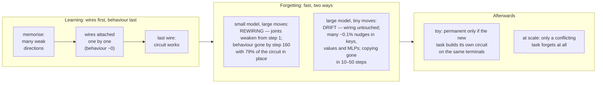

# A detailed timeline of catastrophic forgetting through the weights

### A circuit view in which grokking and catastrophic forgetting are two faces of the same coin

Parag Garg. Draft of 25 October 2026.

*Working draft. Where each number comes from — the
STATE point, the result file and the tool — is listed under "Provenance" at the end. A 10-page short
version with the diagrams: `docs/PAPER1_SHORT.pdf`.*

---

## Abstract

Catastrophic forgetting — a network losing what it knew as soon as it learns something new — is
among the largest obstacles to AI that keeps learning after deployment. Overcoming it needs a
detailed account of what happens inside a network as it forgets. We give one, from the weights and
from random-token probes — no stored data of either task — for two capabilities whose circuits are
known: modular addition in a small grokked transformer, and induction (copying what followed a
token's earlier occurrence) in Pythia, repeated up the Pythia family and in Qwen2.5. In both, grokking
and forgetting are two faces of one coin: the circuit's connections are in place before the behaviour
appears, and the behaviour is lost while most of the circuit is still there.

**Building: structure leads behaviour.** The toy's output-layer circuit is at 7.96× its random level
while test accuracy is 14%. In Pythia's own pretraining the induction wiring — previous-token heads
composing into induction heads' keys — is significant at step 512, when copying is still zero and no
induction head attends to its target: in 10–13 of 16 head pairs in each of five Pythia-160m
pretraining seeds, 12 at 1.4b and 14 at 2.8b, but only 4 at 410m. By step 1 000 copying is 0.44–0.69.

**Destroying: the behaviour goes first, in two regimes.** In the toy, interference moves the weights
14–88% and *rewires* the circuit: the connections between matrices weaken from the first steps of
interference (10 of 10 seeds), their significant directions are counted out 10–20 steps later, and
the bulk of the circuit fades about 7× more slowly than the function. In Pythia, anti-induction
destroys copying (0.84 → 0.01 in 50 steps on 3 of 3 seeds) while each induction head's weights move
under 0.3% (about 0.05% when copying has halved) and the wiring does not move; at such displacements
Weyl's inequality lets no spectral measure move much. The loss is *distributed*. An exact
path-integral account over the weights (the parts sum to the loss within 3.8% at 160m and 0.2% in four
larger models) spreads it over the network, centred on the induction heads' layers; per weight, the
attention keys, values and outputs carry 1.2–7× their share in all five models tested (Pythia
160m–1.4b, Qwen2.5 0.5B–1.5B). Returning the 80 top-ranked parts restores copying to 0.62–0.66 at 160m
(three seeds; random parts of the same kinds and sizes: 0.17–0.30) and to 0.17–0.86 in the four larger
models (random: at most 0.008). On natural text, which the update never trained on, the same damaged
models still copy a repeated passage at 60–92% of their healthy gain.

**At scale, forgetting needs conflict.** A new task that contradicts copying (copy-with-offset)
destroys it in 13 of 13 runs (to 0.000–0.002: five fine-tuning seeds at Pythia-160m, two each at 410m,
1.4b, Qwen2.5-0.5B and 1.5B); one that does not (an arithmetic rule written as text) leaves it at
0.80–0.97 in 13 of 13, including where the rule is learned to 0.96–0.99. In the toy every interfering
task we tried destroyed or badly damaged addition, each contradicting it on its own inputs or
competing for the same small block, so the toy cannot say whether conflict is needed; there, the loss
becomes hard to undo only once the new task is learned and generalises.

**The same picture up to 14B.** Up the Pythia family to 2.8b and across Qwen2.5 from 0.5B to 14B, base
and instruct, a conflicting update erases copying within about ten steps (fifty at 160m) while the
wiring does not move and general-text perplexity barely registers the loss. A companion eval of 14
models in six families (in preparation) finds that harmless training leaves every tested skill intact
where a conflict halves it, and that a wiped skill returns after a few correct steps on other items:
suppressed, not deleted.

---

## 1. Introduction

### 1.1 Why the anatomy

A model that is trained further loses skills it had (McCloskey and Cohen 1989; French 1999). This is
why deployed models are frozen or retrained from scratch rather than taught as they go, and it is the
central obstacle to continual learning. The standard remedies — replay, penalties on moving important
weights, separate parameters per task — act without an account of what, in the weights, is lost, and
when. A remedy needs to know where to act, and an alarm needs to know what to watch. This paper is
that account, for two capabilities whose circuits are known, followed step by step through building
and through destruction.

### 1.2 The question

The starting point is an observation about trained weights: *shuffle the entries of a trained weight
matrix. The histogram, and so the entropy, is unchanged; the network is dead. Whatever survives the
shuffle is distribution; whatever dies is organisation.* (The shuffle null itself is from the
random-matrix line of Martin and Mahoney; §2.) The expected consequence was that organisation should
show in the weights before it shows in behaviour. As an early-warning signal, this weight structure
failed (§9). Tracked through learning and through forgetting, it gives the main result: **structure
leads behaviour in learning and trails it in forgetting.** In the toy this is a statement about
rates. At scale the wiring forms ahead of copying, and in forgetting it does not move at all — at
fine-tuning's displacements it cannot move much (§1.4) — so there the structure outlasts the loss.

### 1.3 A capability is a circuit, built and broken differently

**Figure 1 — the circuit picture.** Nodes are matrices, each drawn with its spectrum (peaks above the
shuffle edge, a base below); wires are the connections between matrices; five panels run from
memorising, through wiring, to rewired. *Drawn version: `docs/figures/circuit_figure_paper.html`
(image: `docs/figures/fig_circuit.png`); a sixth
panel for the distributed regime — wiring intact, many small changes — is still to add. The flowchart
is the content outline.*

Building a capability is like wiring a circuit: every wire has to be attached before it works, so
nothing shows in behaviour until the last connection is made — then accuracy jumps. Breaking it takes
far less, in one of two ways. In a small network the new task pulls wires: it takes the circuit's
terminals for its own use. In a large network nothing is unplugged. It is more like a mixing desk on
which no cable is pulled but dozens of faders are each nudged down a little: the wiring is intact and
the signal is gone. In both, the behaviour dies while most of the circuit is still in place.

### 1.4 Two regimes, and which one the weights can show

Weyl's inequality bounds how far any singular value can move under a change ΔW by ‖ΔW‖₂, and
Davis–Kahan bounds how far singular directions can turn by ‖ΔW‖₂ divided by the gap to the next
value. Every structural statistic used here is a function of singular values or directions. So the
displacement of the weights, ‖W_t − W_0‖_F / ‖W_0‖_F, limits what the weights can show. Interference in
the toy moves them 14–88% (the keys 57% within 20 steps); fine-tuning Pythia-160m moves them 0.1–1.3%,
and each induction head's queries and keys by about 0.05% when copying has halved. Behaviour has no
such bound: a change in the output is a sum over every parameter of gradient × change, and a softmax
turns a score shift δ into a factor e^δ in attention odds. So in the toy the measures can see the
rewiring, and do; at scale they can barely move, and the forgetting has to be read another way — by
an exact attribution of the loss to parts, and by behavioural probes on random tokens, which need no
stored data. The regimes are not an artefact of the learning rate (§8): over a 100-fold range of
rates the toy forgets at the same displacement, and Pythia at rates 10–33× higher is destroyed within
two steps with its wiring unchanged. Each model forgets at its own displacement; the rate mostly sets
how many steps that takes.

### 1.5 Contributions

The measures of structure and of the skill are data-free: they read the weights, or the model's
behaviour on random-token probes; no training or test data of either task is stored or needed.
Natural text enters only as a reference — general-text perplexity (the usual health check), wikitext
fine-tuning as the harmless control, and one in-context check (§7.2).

1. **A timeline of building and destroying a capability, in two regimes with known circuits**
   (§5–7): structure leads behaviour while the capability forms (toy 7.96× random at 14% accuracy;
   the induction wiring significant at step 512 with copying zero in five Pythia-160m pretraining
   seeds, at 1.4b and 2.8b, and only just at 410m) and trails it while the capability is destroyed
   (toy: 79% of the circuit present when the capability is gone; Pythia and Qwen: the wiring unchanged
   when copying is gone).
2. **Two regimes of forgetting — rewiring and distributed drift — and why the weights show one and
   not the other** (§3.3, §8): Weyl's inequality applied to the displacement.
3. **In the rewiring regime the connections between matrices move with the behaviour** (§6.2): the
   null-calibrated strength of specific writer→reader connections falls from the first steps while
   every matrix's own structure is unchanged; the count of significant directions is a lagging
   summary.
4. **An exact account of distributed forgetting** (§7.4–7.5): a path integral over the weights whose
   parts sum to the loss, validated causally in five models — the 80 top-ranked parts restore far more
   than random parts of the same kinds and sizes (2–6× more at 160m; 0.17–0.86 against at most 0.008
   above). Per weight the attention side — keys, values and outputs, not queries — carries the most.
   On natural text the skill largely survives (§7.2).
5. **When forgetting happens and when it lasts** (§6.6–6.7, §7.6): at scale, a conflicting new task
   forgets and a non-conflicting one does not (13 of 13 runs each, two families); in the toy
   destruction is universal, permanence waits for the new task to be learned, and recovery is a
   rate, not a cost.

---

## 2. Related work

Full table: `docs/LITERATURE_2026-10-23.md`. **[Every citation to be checked against the paper.]**

**Where forgetting happens.** Ramasesh, Dyer and Raghu (2021, 2007.07400) locate forgetting in the
higher layers of image classifiers by activation similarity, freezing and reset, and find it worst
at intermediate task similarity. In induction forgetting the loss is centred on the circuit's own
layers — layer 4 of 12 carries 25% in Pythia-160m — and the top layer carries under 1% in all five
models we account for (§7.4); the heads that matter most to language are early ones (§4.2). In the
toy, by recovery cost, similar tasks recover instantly, multiplication cheaply in 40 of 73 cells,
max(a, b) in 0 of 73: monotone, not intermediate-worst (§6.6). They measure the loss, we measure the
way back.

**Forgetting as broken alignment rather than lost features.** Spurious forgetting (Zheng et al. 2025,
2501.13453), *Diagnosing Catastrophe* (Anthes et al. 2023, 2310.05644), *Putting a Face to
Forgetting* (Masip et al. 2026, 2601.22012), *Lost or Hidden?* (Filus et al. 2026, 2605.16374) and
accessibility collapse (Trivedi and Melwani 2026, 2606.06032) argue, from activations and probes, that
much forgetting is loss of alignment or access. We locate the loss in the weights and time it; at
scale it is neither a lost feature nor a lost connection but a distributed change (§7).

**Connections between components.** Composition scores and virtual weights (Elhage et al. 2021);
low-rank communication channels from weight SVDs (Talking Heads, Merullo et al. 2024, 2406.09519),
who report composition scores noisy at GPT-2 scale; a static writer→reader coupling with an exact
Haar-rotation null, scored per head (Wang 2026, 2608.22007, final checkpoints only); and
consecutive-layer singular-vector alignment tracked through training, including grokking, without a
null (Yunis et al. 2024, 2408.11804). Ours is the dynamics, through building and through forgetting.

**Induction heads and the phase change.** Induction heads and their K-composition with previous-token
heads (Elhage et al. 2021; Olsson et al. 2022), who show they form in a sudden phase change early in
training. Pythia's public checkpoints (Biderman et al. 2023), the extra pretraining seeds of
PolyPythias (van der Wal et al. 2025 **[verify]**) and OLMo's snapshots (Groeneveld et al. 2024
**[verify]**) let us time the wiring against the behaviour at four sizes, over five seeds and in a
second family (§5.2).

**Fine-tuning and in-context skills.** In linear attention, fine-tuning destroys in-context learning
through the query–key block, and updating only the values preserves it (Lee, Sohn and Lee 2026,
2602.23197); in Llama-2-7B an attention-sensitivity proxy can rise while in-context behaviour does
not (Zhang et al. 2026, 2609.00064); ablating induction heads cuts in-context learning in large
models (Findings of NAACL 2025 **[full citation to find]**); fine-tuning objectives raise or lower
induction-head counts (2505.14233 **[authors to add]**). In softmax models we find the loss is not in
the induction heads' own queries and keys (restoring them returns 0.014) but spread over keys in many
heads, values and MLPs (§7.3–7.5).

**Attribution through the weights.** Integrated gradients (Sundararajan et al. 2017) integrate
gradient × change along a path from a baseline, with completeness: the parts sum to the total.
Attribution patching (Nanda 2023; Syed et al. 2023) is its first-order linearisation, and skill
localisation by grafting a small set of fine-tuned parameters (Panigrahi et al. 2023) is its causal
cousin. We integrate over the weights, from the healthy to the damaged model, and check the ranking
by restoring parts against random parts of the same kinds and sizes.

**Suppression rather than deletion, and what predicts forgetting.** Fine-tuning often adds a
removable "wrapper" around a skill instead of deleting it: skills return within tens to thousands of
steps, under translated prompts, or to a linear probe (Jain et al. 2024, 2311.12786; Kotha et al.
2024; Zhang et al. 2024 **[last two to verify]**). Our distributed regime fits that picture — the
wiring is untouched, copying returns in 50 steps of correct copies (§11), and it largely survives on
natural text while random-token copying is gone (§7.2). Forgetting is bounded by curvature ×
displacement² (Mirzadeh et al. 2020 **[verify]**); sensitivity to random weight perturbations grows
with pretraining tokens (Springer et al. 2025, 2503.19206); across training methods, the KL from the
base model predicts forgetting better than weight-change norms (RL's Razor, Shenfeld et al. 2026,
2509.04259) — within one objective, we find a nearly fixed displacement (§8).

**Same-format interference and its remedies.** New facts taught in a known template damage known
facts (Gekhman et al. 2024; Kaplan et al. 2026), and in Kaplan et al. opaque subject names cost only
0–4 points; the capture we report survives that control (§7.6). Rehearsal with the model's own
answers is a published remedy (Self-Synthesized Rehearsal, Huang et al. 2024), and protections that
act on the weights — freezing by attribution among them — fail in the continual-learning literature
(van de Ven et al. 2022; Wei et al. 2024), as they did in the companion's stream of skills (§11).

**Attention sinks and perturbation bounds.** Heads park attention on the first token when they have
nothing to attend to (Xiao et al. 2023; Sun et al. 2024, massive activations). Weyl (1912) and
Davis and Kahan (1970) bound how far spectra and singular directions move under a perturbation.

**Grokking and forgetting.** *The Grokked Illusion* (Zhang et al. 2026, 2607.29503) shows grokked
models forget under random-label interference and analyses per-matrix effective rank; random labels
cannot be learned in a way that generalises, so they cannot show when a loss becomes permanent
(§6.6). Multi-task grokking (Xu 2026, 2602.18523) trains jointly. Jia (2026, 2609.18078) splits a
grokked model into embedding/unembedding and the block, and finds freezing the former cuts post-grok
relapse.

**How each prior result is used — built on, compared against, or extended.**

| prior work | what we take | what we add or test against it |
|---|---|---|
| WeightWatcher / Prakash & Martin (2605.12394) | the per-matrix shuffle null | used as is; a per-matrix baseline, blind at the moment of forgetting in both regimes (§6.2, §7.1) |
| Elhage et al. 2021 — composition score | the joint score itself | against an exact null it moves with the behaviour from the first step; its raw ratio is a weaker reading of the same quantity (§6.2) |
| Wang 2026 (2608.22007) — communication map, Haar null | the exact null E[C²] = 1/d with closed-form variance; BH correction; per-head scoring | the map through time — which connections weaken first, and when; at scale, a map that picks out the important heads (§4.2) |
| Yunis et al. 2024 (2408.11804) | alignment as a quantity that moves in training | a null, the destruction direction, and the rebuild |
| Merullo et al. 2024 — Talking Heads | the warning that whole-matrix scores are weak at scale | at scale the scores barely move, by Weyl, not just noisily (§3.3, §7.1) |
| Olsson et al. 2022; Biderman et al. 2023; van der Wal et al. 2025 | the induction phase change; public checkpoints; seeds | the wiring is significant before the behaviour appears, at four sizes, five seeds and in OLMo (§5.2) |
| Sundararajan et al. 2017; attribution patching; Panigrahi et al. 2023 | completeness; grafting | an exact account of forgetting over the weights in five models, checked by restoring parts against size-matched random ones (§7.4–7.5) |
| Xiao et al. 2023; Sun et al. 2024 — sinks | where attention goes when there is nothing to attend to | the induction heads' attention slides to the sink as copying dies — a symptom, not the seat (§7.3) |
| Lee, Sohn & Lee (2602.23197) | in-context skill lost through query–key | in softmax attention, distributed over keys, values and MLPs (§7) |
| Spurious forgetting, Diagnosing Catastrophe, accessibility collapse, Masip et al. | forgetting as lost alignment or access | located in the weights and timed; at scale, a distributed change (§7) |
| Ramasesh et al. 2021 | forgetting is localised; similarity matters | centred on the circuit's own layers, not the top (§7.4); a monotone similarity–recovery ordering in the toy (§6.6) |
| Kaplan et al. 2026; Gekhman et al. 2024 | same-template facts interfere; opaque names as the control | a new answer format captures old prompts of the same few-shot form even under opaque names (§7.6) |
| The Grokked Illusion (2607.29503) | grokked models forget | only a second task that is really learned shows when the loss becomes permanent (§6.6) |
| Jia 2026 (2609.18078) | the E/U vs block split | in our toy the block restores reliably, the embedding alone often, the joint ends not (§6.8) |

**The measures are borrowed and adapted, not the contribution.** The per-matrix null is from the
WeightWatcher / random-matrix line (Martin and Mahoney; Prakash and Martin 2026, 2605.12394). The
joint measure is Elhage et al.'s composition score against Wang's exact Haar null. The attribution
is integrated gradients applied to weights. What is new is what they show when followed through a
capability's life.

---

## 3. Method

**Figure 2 — the measures.**

```mermaid
flowchart TB
    subgraph IN["Inside a matrix (shuffle null)"]
      W["trained W"] --> S["shuffle W's own entries"] --> E["edge = largest eigenvalue<br/>of the shuffled spectrum"]
      W --> SP["spectrum of W"]
      E --> K{"count directions<br/>above the edge"}
      SP --> K
      K --> KO["k: organised directions<br/>(survive the shuffle = distribution;<br/>die in it = organisation)"]
    end
    subgraph BETWEEN["Between matrices (the joints)"]
      WR["writer, e.g. embedding"] --> ST["shared residual stream"]
      ST --> RD["reader, e.g. attention keys"]
      WR --> P["path = reader × writer"]
      RD --> P
      P --> Q["rotate the stream at random:<br/>keeps each part's own spectrum,<br/>destroys only their alignment"]
      Q --> KR{"strength z against the exact null;<br/>wires = singular values above<br/>the largest under rotation"}
    end
    subgraph SMALL["When the weights barely move (Weyl)"]
      PR["random-token probes:<br/>behaviour and attention,<br/>no stored data"]
      AT["exact attribution:<br/>loss change split over parts<br/>along healthy → damaged"]
      AT --> RS["check: restore top parts<br/>vs random parts of the<br/>same kinds and sizes"]
    end
```

### 3.1 Inside a matrix

For W, form λ_i = s_i²/n. Shuffle W's entries and take the largest eigenvalue of the shuffled
spectrum as an edge (maximum over four shuffles, × 1.02). Directions above the edge — their number is
**k** — are structure that permutation destroys. Both constants are swept: k moves by at most two
over a tolerance of 0.90–1.10 and 1–16 shuffles. The null chooses *how many* directions per matrix,
never *which*: above-edge and top-k by magnitude at k = n_above are the same selection.

### 3.2 Between matrices

Every matrix touches the residual stream on one side: writers (embedding, attention output, MLP
output) map into it, readers (queries, keys, values, MLP input, unembedding) read from it. For writer
W and reader R the path is R W, with composition score C = ‖R W‖_F / (‖R‖_F ‖W‖_F) (Elhage et al.).
A Haar-random rotation Q of the stream gives R Q W, which keeps both matrices' spectra and destroys
only how they line up. Under it E[C²] = 1/d exactly, and the variance follows in closed form from the
moments of squared Haar-orthogonal entries (E[Q²] = 1/d; E[Q⁴] = 3/(d(d+2)); pairs sharing a row or
column 1/(d(d+2)); otherwise (d+1)/(d(d−1)(d+2))), as in Wang (2026). Toy d = 128; Pythia-160m
d = 768, LayerNorm gains folded into readers, parallel residual respected, attention scored per head,
thin SVDs so the 50 304-row embedding costs one decomposition. Qwen2.5 and OLMo use the same per-head
matrices through one adapter: a grouped-query head reads through its shared key head, and OLMo's
gain-free LayerNorm folds in as ones.

**Terms.** A writer→reader pair is a **joint**. Its **strength** is z = (C² − E[C²])/sd, with a
one-sided p and Benjamini–Hochberg significance at 0.05 across all joints scored together; its **wire
count** is the number of singular values of R W above the largest under four sampled rotations. At
scale, **the wiring** means the K-composition joints from the four strongest previous-token heads
into the four strongest induction heads' keys (16 head pairs): their mean strength and how many are
significant.

### 3.3 What the weights can show: displacement and Weyl

For any change ΔW, |σ_i(W + ΔW) − σ_i(W)| ≤ ‖ΔW‖₂ ≤ ‖ΔW‖_F (Weyl), and singular subspaces turn by at
most about ‖ΔW‖₂ / gap (Davis–Kahan); the same holds for a product R W when either factor changes. We
report displacement as ‖W_t − W_0‖_F / ‖W_0‖_F, so every singular value moves by at most that fraction
of ‖W_0‖_F — for the leading directions of a matrix with r comparable singular values, at most about
√r times that fraction of their own size. At the 0.1–1% displacements of fine-tuning every statistic
in §3.1–3.2 can therefore move only a little, though a count of directions sitting near an edge can
still flip. We log the displacement of every matrix as the clock. The output is not bounded this way:
its change is a sum over all parameters of gradient × change, so many small changes aligned with the
new task's gradient can move it a long way while no single matrix moves visibly.

### 3.4 Behaviour without stored data: random-token probes

Pythia and Qwen: 64 random-token sequences of length 40 (token ids 1 000–20 000), each repeated
twice. **Copying** (induction accuracy) is next-token accuracy on the second copy. Head scores:
attention from second-copy position i to i − 39 (the token after the earlier occurrence; induction)
and to i − 1 (previous token). Per head, attention to position 0 (the sink), and the **gate margin**
log a_target − log a_sink, which equals the score difference exactly because the softmax denominator
cancels. Toy: random (a, b) probes; per head, the attention of '=' to a and to b, and the **a/b split**
|log a_a − log a_b|. No probe uses training or test data of either task.

**The natural-text check** (§7.2) reads damaged models on wikitext-2 test text, which no fine-tune
here trains on. Olsson et al.'s **in-context learning score** is the mean loss on tokens 400–510 of a
512-token window minus the mean loss on tokens 40–63 (32 windows); more negative means later tokens
gain more from the context. **Natural-text copying** shows 64 passages of 40 tokens twice; the gain
kept is (damaged second-copy accuracy − first-copy accuracy) / (healthy second-copy − first-copy).

### 3.5 Exact accounting: attribution along the weights

For a loss L and the straight path θ(α) = θ_0 + α(θ_1 − θ_0) from the healthy to the damaged model,
L(θ_1) − L(θ_0) = ∫₀¹ ∇L(θ(α)) · (θ_1 − θ_0) dα exactly. Splitting the dot product by parts — each
head's query, key and value weights and biases and its output columns, each layer's MLP input and
output, LayerNorms, embedding, unembedding — gives each part's share. L is the copy loss on 32
random-token probe sequences; midpoint quadrature with K = 16; the residual is reported. The causal
check returns the top-N parts to their healthy values in the damaged model and compares with random
parts of the same kinds and sizes, two draws per N; each restore is reported with the share of the
attention and MLP weights it puts back. Size matters here: per-head parts are many and small, whole
MLP matrices few and large, so N random parts of any size put back far fewer weights than the top N.

### 3.6 Settings

**Toy.** One-layer transformers, d = 128, four heads, modular arithmetic mod 113, full-batch AdamW
(learning rate 1e-3, weight decay 1.0), following Nanda et al. Task A is addition at 30% of pairs;
interference trains on task B alone at its own data fraction (multiplication at 25% unless stated);
recovery retrains on A's training split with the interference optimiser carried over. Recovery cost
is steps to 0.90 test accuracy, logged every 100 steps, budget 20 000, unless stated. A **cell** is one
configuration (seed, interference task and length) run once.

**Pythia-160m** (Biderman et al. 2023). AdamW, weight decay 0.01, batch 8, learning rate 3e-6 (and
1e-6) — 20–60× below the final pretraining rate (peak 6e-4, decayed to a tenth; Biderman et al. 2023,
Table 1). Old skill: copying, on fresh random-token probes. Interfering tasks: **anti-induction** —
the same kind of repeated sequences with each second-copy target replaced by a fixed random
permutation of the copied token (contradicts copying on every input); **copy-with-offset** — predict
the token two after the earlier occurrence (contradicts it, re-pointing the same circuit); an
**arithmetic rule**, "a + b = c" mod 50 written as text (no conflict). Control: fine-tuning on
wikitext. A **fine-tuning seed** fixes the order of training batches on one pretrained model.

**Larger models and a second family.** Pythia-410m, 1.4b and 2.8b; Qwen2.5-Instruct 0.5B, 1.5B, 3B,
7B and 14B, with the base 7B and 14B. Full fine-tuning in float32 on CPU nodes, never LoRA, which
would constrain the very update being measured; the same rates, batch and probes.

**Pretraining checkpoints** (§5.2). Pythia's public checkpoints at steps 0, 64, 128, 256, 512, 1 000,
2 000–6 000, 8 000, 10 000, 15 000, 20 000, 40 000, 80 000 and 143 000 for 160m, 410m, 1.4b and 2.8b;
the same steps of four more Pythia-160m runs that differ only in their **pretraining seed**
(PolyPythias); and the nine snapshots of OLMo-7B-0724 (steps 0, 1 000, 5 000, 20 000, 50 000, 100 000,
200 000, 400 000 and 650 650). The heads are identified once, in each final model. *Pythia-2.8b's hub
snapshots carry stale files:* every revision from step 0 to step 80 000 lists the same single-file
`model.safetensors`, identical to the final model's (largest difference 0.0), and steps 0–20 000 the
same `pytorch_model.bin`; only the two-part sharded files of steps 0–20 000, and the `.bin` of 40 000
and 80 000, differ from step to step. A default `from_pretrained(..., revision="step512")`, which
prefers the single file, therefore returns the finished model. We use, for each revision, the file
unique to it, and check that step 0 loads its own weights. Pythia-160m, 410m and 1.4b have a distinct
file at every step, and their half-precision files equal the full-precision ones exactly once upcast.

---

## 4. What a formed capability looks like

### 4.1 In the toy

**A flat plateau.** 6–9 directions per matrix carry 95–99% of its spectral mass (the sum of its
squared singular values), with normalised entropy 0.938–0.991 against ~0.60 for a power law — 120
checkpoints from four models (two tasks at two training fractions) over three seeds. It is not one
spike but a few nearly equal towers.

**They are the known circuit.** Their power concentrates in Nanda's key frequencies — {15, 22, 42,
46} recur — at 6.4–6.8× a rank-matched random subspace (±0.4 between random draws), and 1.1–1.5×
during memorisation. Taking the top-k by magnitude finds the same directions; this is evidence of
low rank, not of the null.

**They carry it, with a matched control.** Implanting the 65 above-edge directions of a grokked donor
into a memorising model of the same run, then 200 steps on A's data: 0.9012. The other 816: 0.0182.
**65 random directions: 0.0096**, identical to doing nothing (0.0095). Entries shuffled: 0.1853.
Uniform top-9 per matrix reaches 0.774 and top-16 beats the null (0.915): the null is an efficient
budget allocator, not a unique identifier.

**Only within a lineage.** 0.7574 from a model's own earlier self; 0.0084 from an independently
trained model of the same task, below doing nothing (0.0167). Two independent solutions overlap at
0.238 against a 0.197 floor, agree on every answer and on no runner-up, and no permutation relates
them.

### 4.2 At scale: the weights-only map picks out the heads that matter

In pretrained Pythia-160m, scored per head against the exact null, embedding → keys is significant
for 18 of 144 heads (12 of them in layer 0) and attention output → unembedding for 42 of 144 (rising
with depth; all 12 in layer 11). Zeroing each head in turn (wikitext perplexity, baseline 87.9): the
18 embedding → keys heads raise it by +5.46 on average against +1.80 for all heads and +0.68 for the
output → unembedding heads; 10 of the 20 most important heads are among the 18. The most important
heads are early (L0H4 +22.1, L1H8 +21.7, L0H6 +16.5); layers 9–11 are mostly below +1.

**The induction circuit, from weights and attention.** Induction heads L4H6 (score 0.928), L8H2
(0.895), L5H0 (0.742), L4H8 (0.722); previous-token heads L3H2 (0.959), L3H0, L1H2, L3H1. Copying
0.841. The wiring: mean strength z = 115.9 over the 16 pairs (max 339), 14 of 16 significant;
embedding → induction keys at chance — the textbook circuit (Olsson et al. 2022).

---

## 5. Building: structure leads behaviour

### 5.1 In the toy

Addition from scratch: the training set is memorised by epoch 1 000; test accuracy stays near zero
for 34 000 epochs, then climbs 10% → 99% between 35 000 and 39 000. Every toy building number is from
this one run.

| epoch | test accuracy | output-layer Fourier concentration (× random) | embedding (× random) |
|---|---|---|---|
| 5 000–15 000 | 0.004–0.007 | 1.1–1.5 | 1.05–1.20 |
| 20 000 | 0.009 | 2.56 | 1.40 |
| 30 000 | 0.034 | 6.63 | 2.35 |
| **35 000** | **0.140** | **7.96** | 2.92 |
| 40 000 | 1.000 | 6.10 | 5.70 |
| 72 000 | 1.000 | 6.50 | 6.33 |

The output layer's circuit is complete while the model is right 14% of the time; the embedding fills
in last. In matrix terms the transition goes from many weak directions to a few strong ones. The
joints form with the circuit: composition score (× rotation baseline), memorising (5 000) → grokked
(72 000): embedding → keys 1.18 → 2.71; embedding → values 1.84 → 3.54; attention → MLP 1.67 → 3.00;
attention → output 1.07 → 1.69; MLP → output 1.56 → 3.71.

### 5.2 At scale: the induction wiring forms before copying

Pythia-160m's public pretraining checkpoints, with the heads identified in the final model:

| step | copying | L4H6 induction score | wiring strength z, mean / max (16 pairs) | significant pairs | query/key/value movement per step |
|---|---|---|---|---|---|
| 0–256 | 0.000 | 0.01–0.02 | 0.5–0.7 / 2.4–2.5 | 0 / 16 | 0.02–0.05% |
| **512** | **0.000** | **0.02** | **8.2 / 33.7** | **11 / 16** | 0.048% |
| 1 000 | 0.607 | 0.94 | 46.1 / 194 | 15 / 16 | 0.053% |
| 2 000 | 0.708 | 0.97 | 74.0 / 249 | 16 / 16 | 0.052% |
| 5 000 | 0.882 | 0.97 | 104 / 296 | 16 / 16 | 0.029% |
| 20 000 | 0.899 | 0.96 | 126 / 330 | 15 / 16 | 0.0074% |
| 80 000 | 0.884 | 0.92 | 131 / 362 | 14 / 16 | 0.0018% |
| 143 000 | 0.841 | 0.93 | 116 / 339 | 14 / 16 | 0.0011% |

At step 512 the wiring is significant in 11 of 16 pairs while the induction heads do not yet attend
to the induction target and copying is zero; by step 1 000 copying is 0.61. The lead is bounded by
the checkpoint spacing: none exist between 512 and 1 000. The second induction head forms slowly
(L8H2 0.04 at 1 000, 0.89 at the end) and the wiring keeps strengthening after copying saturates.
The weights settle gradually: movement per step falls 50-fold from the phase change to the end, while
the distance from the final model, ‖W_t − W_final‖_F / ‖W_final‖_F, is still 0.61 at step 80 000.

**Five pretraining seeds and four sizes.** The same measurement on four more Pythia-160m runs that
differ only in their pretraining seed, and on Pythia-410m, 1.4b and 2.8b, each with its own heads:

| run | steps 0–256: significant pairs | step 512: copying | step 512: z, mean / max | step 512: significant pairs | step 512: best induction score | step 1 000: copying | step 1 000: significant pairs |
|---|---|---|---|---|---|---|---|
| 160m, seed 0 | 0 | 0.000 | 8.2 / 33.7 | 11 / 16 | 0.03 | 0.607 | 15 / 16 |
| 160m, seed 1 | 0 | 0.000 | 10.4 / 38.9 | 11 / 16 | 0.04 | 0.599 | 16 / 16 |
| 160m, seed 2 | 0 | 0.000 | 4.3 / 12.8 | 13 / 16 | 0.03 | 0.604 | 16 / 16 |
| 160m, seed 3 | 1 | 0.000 | 8.1 / 43.0 | 11 / 16 | 0.04 | 0.589 | 16 / 16 |
| 160m, seed 4 | 0 | 0.000 | 4.2 / 10.8 | 10 / 16 | 0.05 | 0.603 | 16 / 16 |
| 410m | 0–1 | 0.000 | 1.1 / 4.5 | 4 / 16 | 0.02 | 0.439 | 16 / 16 |
| 1.4b | 0 | 0.000 | 5.3 / 14.8 | 12 / 16 | 0.03 | 0.686 | 16 / 16 |
| 2.8b | 0 | 0.000 | 4.3 / 10.3 | 14 / 16 | 0.03 | 0.595 | 16 / 16 |

In every run the wiring is significant at step 512 while copying is exactly zero and no induction
head yet attends to its target (best score 0.02–0.05, against 0.85–0.96 at step 1 000): in 10–14 of
16 pairs in seven runs, and in 4 of 16 at 410m, where the lead is marginal — mean z 1.1, and the same
run already shows one significant pair at steps 64–256, as one 160m seed does at step 0, so one in 16
is about the false-positive rate. By step 1 000 copying is 0.44–0.69 and the wiring is significant in
15–16 of 16 everywhere. Each final checkpoint reproduces the healthy model of §7.7 (2.8b: copying
0.927, wiring z 364.0). The settling repeats: query/key/value movement per step falls 37–71-fold from
step 1 000 to the end (160m seeds 38–48, 410m 37, 1.4b 71, 2.8b 70), and at step 80 000 the distance
from the final model is still 0.58–0.64 (160m), 0.49 (410m), 0.28 (1.4b) and 0.25 (2.8b).

**Figure 3 — the induction wiring starts before copying, at every Pythia size and in OLMo.** Copying
(orange) and the share of the 16 previous-token → induction-key pairs that are significant (blue),
through each model's own pretraining; the five 160m pretraining seeds are overlaid, the original in
bold. The grey band marks the interval in which copying appears and no checkpoint exists (steps
512–1 000 in Pythia, 1 000–5 000 in OLMo). Step 0 (both series zero) is off the log axis.

**A second family: OLMo-7B.** OLMo-7B-0724's nine snapshots are spaced more coarsely, and its phase
change comes later in tokens:

| step (tokens) | 0 | 1 000 (4B) | 5 000 (20B) | 20 000 (83B) | 50 000 | 100 000 | 200 000 | 400 000 | 650 650 (2.7T) |
|---|---|---|---|---|---|---|---|---|---|
| copying | 0.000 | **0.010** | 0.779 | 0.891 | 0.933 | 0.926 | 0.927 | 0.903 | 0.926 |
| significant pairs | 0 / 16 | **3 / 16** | 7 / 16 | 13 / 16 | 16 / 16 | 16 / 16 | 15 / 16 | 15 / 16 | 15 / 16 |
| wiring z, mean / max | 0.2 / 2.1 | **12.4 / 78.9** | 50.9 / 472 | 97.2 / 1 045 | 105 / 1 079 | 125 / 1 097 | 152 / 1 250 | 156 / 1 229 | 152 / 1 279 |
| best induction score | 0.02 | 0.18 | 0.94 | 0.90 | 0.86 | 0.87 | 0.88 | 0.92 | 0.92 |

At step 1 000 the wiring has started — 3 of 16 pairs significant, one head beginning to attend —
while copying is 0.010. By step 5 000 copying has run ahead (0.78) of the wiring measured on the
final model's heads (7 of 16), which fills in only by step 50 000, much as Pythia-160m's second
induction head forms long after copying works. So OLMo shows the onset of the wiring before the
behaviour, not a finished circuit before it; its coarse spacing cannot say more.

---

## 6. Destroying in the toy: rewiring

### 6.1 Destruction is immediate, and universal

Training the grokked addition model on multiplication (25% of pairs), addition falls to 0.54 by step
20, 0.09 by 60 and ~0.05 by 160, on every seed (4.6% / 5.2% / 5.4% at step 160). Every interfering
task tried destroys the victim — subtraction and aff7 (to 0.0097), max(a, b) (0.0186, 2 of 2), random
labels — or badly damages it (mod97, to 0.37); and the victim need not be addition: squared-sum is
destroyed by addition (0.009, 5 of 5) and by multiplication (0.002, 5 of 5), though multiplication
reaches only ~0.30 from that start. Every one of these tasks is posed on exactly addition's inputs,
(a, b, =), so each contradicts it there; with an operator token that tells the tasks apart, so that
they no longer share inputs, addition is still destroyed (0.9977 → 0.0085) — the two tasks then
compete for the same small block.

### 6.2 The joints move with the behaviour; their counts lag

Every step from 0 to 40, add←mul on 10 seeds, add←max(a, b) on 3, and a control on 3 that keeps
training addition. Means:

| step | addition, under mul | embedding → keys strength z | its wire count | MLP out → unembedding wire count | control z |
|---|---|---|---|---|---|
| 0 | 1.00 | 27.2 | 3 | 8.3 | 27.2 |
| 1 | 1.00 | 26.2 | 3 | 8.4 | 27.0 |
| 2 | 0.99 | 25.2 | 3 | 8.3 | 27.0 |
| 3 | 0.84 | 24.3 | 3 | 8.4 | 26.9 |
| 10 | 0.87 | 18.5 | 3 | 7.9 | 26.2 |
| 20 | 0.54 | 16.3 | 1.5 | 6.4 | 26.0 |
| 60 | 0.09 | 21.5 | 1 | 3.9 | 26.9 |
| 160 | 0.05 | 22.6 | 1 | 3.6 | 29.3 |
| 400 | 0.02 | 23.3 | 1.6 | 4.9 | 27.2 |

Per seed, the embedding → keys strength is more than 5% below its start at step 2 in 10 of 10 seeds,
one step before test accuracy first falls below 0.90 (step 3, 10 of 10); the control's stays within
5% until step 10–11 (2 of 3 seeds) or throughout (1 of 3). Accuracy is a thresholded readout, so
"one step before" means the joint moves at least as early as the behaviour, not that it predicts it.
The wire count first drops at steps 13–21 (10 of 10) and MLP out → unembedding anywhere from 2 to 23.
The raw composition ratio is a weaker reading of the same quantity (2.61 → 2.28 by step 20, −13%,
against −40% for z; control flat at 2.64–2.66). The strength then partly returns (16.3 at step 20,
23.3 by 400; the count back to 3 by step 1 000) as multiplication builds its own use of the
embedding → keys connection: the terminals are re-used.

Which wires go, and when their counts cross, depends on the pair. With max(a, b) addition falls
faster (0.52 at step 3, 0.07 at 10; strength and accuracy both cross at step 2, 3 of 3), the
embedding → keys strength falls further (27.2 → 9.3 by step 40, back to 28.2 by 400) but its count
crosses only at 25–60, and MLP out → unembedding does not drop within the first 200 steps (later in
two of three seeds, at 240 and 1 250; never in the third). "Two wires pulled at step 20" is
add←mul-specific; the strength moving at once is not.

Throughout, every matrix's own k is unchanged (at step 160: embedding 10, attention output 16 → 15,
unembedding 9): the parts show nothing, the connections between them do.

### 6.3 The parts keep their shape while their contents are rewritten

Displacement ‖W_t − W_0‖_F / ‖W_0‖_F (add←mul, seed 0):

| matrix | step 20 (A = 0.51) | step 160 (A = 0.05) |
|---|---|---|
| embedding | 14% | 31% |
| attention keys | **57%** | **88%** |
| attention output | 16% | 32% |
| MLP output | 27% | 49% |
| unembedding | 27% | 46% |

The largest moves are in the matrices at the ends of the joints that weaken first (keys; MLP output →
unembedding). Each matrix keeps its count of organised directions while its contents are rewritten,
and Weyl permits every spectral measure to move at these displacements — which is why, in this
regime, the joints can and do show the break.

### 6.4 Attention changes with the behaviour, without a sink

The toy has no attention sink: '=' attends to {a, b} with weight ≥ 0.80 throughout every run (low
point 0.85–0.92, back to 0.93–1.00 by step 500; 3 seeds with mul, 3 with max(a, b), 1 control). What
moves is the split between a and b. Grokked heads attend asymmetrically; the mean |log a_a − log a_b|
per head (mul, seed 0) is 1.20 / 1.54 / 1.25 / 1.76 at step 0, 0.97 / 1.26 / 1.00 / 1.46 at step 3
(A 0.85), 0.63 / 0.82 / 0.64 / 0.96 at step 10 and ~0.35 by 60; seeds 1 and 2 alike. In the control it
stays within 0.90–1.71 over 500 steps. Under max(a, b) it falls to ~0.37 by step 40, then rises to
1.8–4.0 by 500, the new task's own pattern. The heads stop telling a from b from step 3, with the
joints.

### 6.5 The bulk of the circuit fades slowly

Output-layer Fourier concentration: 6.43× at step 0, **5.10× at step 160** (79% of grokked, with the
capability gone), down to the memorisation level of §5.1 (1.1–1.5×) between steps 1 000 and 1 250,
and 0.46× — below random — by 6 000 as the layer reorganises around the new task. The embedding keeps
a faint trace longer (1.24–1.82× through steps 1 250–4 750) and loses it when the new task
consolidates, not when recovery turns expensive (3 seeds). Function goes 100 → 5% in 160 steps;
structure takes ~1 000–1 250 to reach the memorisation level, about 7× slower. This is the main
result in the toy: structure trails behaviour in forgetting. The joints' early movement (§6.2) is a
marker of the break, not a counter-example: most of the circuit is still in place when the function
dies.

### 6.6 Permanence is a separate, later event, gated by the new task

In 31 of 32 add←mul runs, four events come in order: addition is destroyed (by ~200 steps) while k is
unchanged; multiplication is learned (~1 900–4 600); k collapses (~4 400–5 600); and only then does
the loss become hard to undo. With add←max(a, b), destruction and the new task's learning both fall
inside the first 200 steps. **The loss turns permanent only once the interfering task is learned and
generalises:** in all 8 runs where multiplication failed to generalise, addition came back; no run
failed to recover while k was high; over 40 cells, with no exception, the switch sits at the
interfering task's own critical data fraction from the grokking literature (multiplication 25%,
subtraction 10–15%). It holds for a second victim:

| pair | cells | cost to 0.90 | budget, logging |
|---|---|---|---|
| add ← sub (B 0.48–0.99) | 4 | ≤ 150, first reading | 3 000, every 150 |
| add ← aff7 (B 1.000) | 2 | ≤ 100, first reading | 20 000, every 100 |
| sq_sum ← mul (B only 0.28–0.32) | 5 | ≤ 100, first reading | 20 000, every 100 |
| **sq_sum ← add (B 1.000)** | 5 | **1 700–4 300**; 2 of 5 plateau at 0.93 | 20 000, every 100 |
| add ← max(a, b) (B 0.96–0.98) | 63 grid + 10 | cheap (≤ 2 000) in 0 of 73; never in 38 of 73 | 20 000, every 100 |
| add ← mul (B 0.50–1.00) | 63 grid + 10 | cheap in 40 of 73; never in 10 of 73 | 20 000, every 100 |

A at 30% of pairs throughout; grid = interference lengths 4 000–8 000 every 200 × seeds 0–2; the
extra 10 are fresh seeds at 5 800. Subtraction generalising fully still costs nothing: it reuses
addition's circuit. The more the new task is addition in disguise, the cheaper the way back. The
collapse of k is **not** the mechanism: it collapses equally in runs whose recovery differs 0.32 vs
0.95. Data volume is not the cause: 25% random labels destroy as thoroughly and return to 1.0000.

### 6.7 Recovery is a rate

The same cell (seed 2, 5 400 interference steps; budget 20 000, logged every 100) run seven times on
different nodes: 14 000, 2 600, 2 600, 8 800, 1 100, 2 600, 14 000 steps. Runs drift apart in the
fourth decimal by step 200. In a dense grid (every 200 steps, 4 000–8 000, 3 seeds) neighbours differ
up to 10×, and the "cliff" and "hill" seen at coarse spacing do not survive. So we report how often
recovery is cheap, not how much one run costs. Measuring the size of a recovery cost robustly — more
seeds per setting, more than one threshold — is future work; nothing here rests on a magnitude.

### 6.8 Repair needs a set of parts

Restoring one part to its pre-interference values, then retraining A (cost to 0.90, budget 20 000,
every 100). At 5 000 interference steps, three seeds:

| restored, then A retrained | seed 0 | seed 1 | seed 2 |
|---|---|---|---|
| nothing | 500 | 1 700 | never (0.59) |
| whole block (attention + MLP) | 300 | 400 | 700 |
| everything except the embedding | 100 | 100 | 100 |
| embedding only | 300 | 200 | never (0.77) |
| attention only | 1 000 | 2 000 | 4 600 |
| MLP only | 800 | 2 300 | 4 500 |
| output layer only | 600 | never (0.44) | 2 200 |

Over 15 runs (5 seeds × 2 000 / 5 000 / 7 000 interference steps; single runs, so only large contrasts
count, §6.7) the block restored together recovers in 200–800 steps in 15 of 15, and with the
embedding added in 100. Single parts are erratic: the embedding alone is about as fast in 12 of 15,
the output layer in 7, attention or MLP alone in 4, and each fails to recover at all in some run.
Restoring only the two ends of the first joints to weaken — the attention keys and the MLP output —
tests whether those two wires are the forgetting (5 seeds, 5 000 interference steps):

| restored, then A retrained | seed 0 | seed 1 | seed 2 | seed 3 | seed 4 |
|---|---|---|---|---|---|
| nothing | 500 | 1 700 | never (0.59) | 1 400 | never (0.71) |
| whole block (attention + MLP) | 300 | 400 | 700 | 400 | 700 |
| keys + MLP out | never (0.72) | 4 300 | never (0.40) | 2 300 | 5 300 |
| keys only | 3 800 | 1 800 | 5 100 | never (0.51) | never (0.76) |
| MLP out only | never (0.77) | 1 700 | never (0.62) | 10 700 | 11 300 |

("never": A still below 0.90 after 20 000 steps, its final accuracy in brackets.) They are not. The
whole block brings A back in 300–700 steps in 5 of 5 seeds; its two joint ends never do as well (2 300–
5 300 steps in 3 seeds, never in 2) and are no better than restoring nothing — worse in 3 of 5 seeds,
both failing in a fourth, ahead only in the fifth (5 300 against never). Either end alone recovers in
3 of 5 seeds and never in 2. A part helps only if it fits what it plugs into. The joints mark where
the break shows; the repair has to replace a set of parts — reliably, the block.

---

## 7. Destroying at scale: distributed drift

### 7.1 A fine-tune that hurts general text moves no joint — and cannot move one much

Pythia-160m learning the arithmetic rule: wikitext perplexity 88 → 145 (1e-6) and → 292 (3e-6) over
3 000 steps; per-matrix k 28.3 → 28.4. Joints over whole matrices (rule, 1e-6, 0–2 750 steps):
perplexity 88 → 138, rule 2% → 66%, every wire count unchanged (embedding → keys 4, MLP outputs →
unembedding 11, embedding → unembedding 0). Per head (300 steps, rule vs a wikitext control, 1e-6):
18 of 144 embedding → keys and 42 of 144 output → unembedding significant at every step in both
runs; the strengths of the ten most important heads within ±0.3% in both. The weights moved 0.09–
0.29% on average (worst matrix 0.64%; 0.65% and 1.28% at 3e-6), so by §3.3 these lines could move
only a little; they are not evidence against joints at scale. Nor was there a circuit to break: the
rule's damage to general text is a diffuse drift, not the loss of one capability.

The shuffle null applied to the update itself, W − W_0, counts fine-tuning rather than forgetting:
its k grows under the wikitext control too, and more (1e-6: 15 → 47 against 11 → 25 under the rule).
Its shape does separate the two — the rule's update is concentrated (mass above the edge 0.86–0.95
against 0.45–0.85) and lies beside the pretrained directions (overlap 0.15–0.19 against 0.23–0.28) —
but random answers to the same prompts, with nothing learnable, give the same shape and more damage
(perplexity 172 against 145): the shape follows the input format, not consolidation (§9).

### 7.2 Destroying a known circuit: induction

Anti-induction at 3e-6 destroys copying in 50 steps, on 3 fine-tuning seeds, with the wiring unchanged
at every mark:

| step | copying, seed 0 | seed 1 | seed 2 | seed 0 at 1e-6 | wiring z (all runs) |
|---|---|---|---|---|---|
| 0 | 0.841 | 0.841 | 0.841 | 0.841 | 115.9 |
| 10 | 0.281 | 0.250 | 0.264 | 0.694 | 115.9 |
| 20 | 0.126 | 0.077 | 0.095 | 0.481 | 115.9 |
| 50 | 0.010 | 0.009 | 0.006 | 0.156 | 115.9 |
| 100 | 0.003 | 0.004 | 0.004 | 0.029 | 115.9 |
| 150 / 200 | 0.002 / 0.001 | — | — | 0.011 / 0.005 | 115.9 |

At 1e-6 it is about 3× slower, by the same route. Seed 0 was continued to step 300 (perplexity 3 553,
copying 0.000): the wiring still read 115.93. Each induction head's queries and keys moved under 0.1%
by step 10 (L4H6: 0.02% and 0.08%) and under 0.21% by step 50 (values 0.27%). The induction heads'
own scores collapse (0.93 → 0.04, 0.89 → 0.08, 0.74 → 0.04, 0.72 → 0.52 by step 200). The wikitext
control at the same rate erodes copying slowly — 0.80 at step 50, 0.74 at 150, 0.61 at 1 000 — with
the wiring at 115.9.

**On natural text the loss is partial.** The seven damaged models of §7.4 (50 steps at 3e-6;
Pythia-160m on three fine-tuning seeds, 410m, 1.4b, Qwen2.5 0.5B and 1.5B), read on wikitext-2 test
text:

| model | random-token copying, damaged | natural-text copying, second copy: healthy → damaged | gain kept | in-context learning score: healthy → damaged |
|---|---|---|---|---|
| Pythia-160m, seeds 0 / 1 / 2 | 0.009 / 0.009 / 0.006 | 0.930 → 0.682 / 0.676 / 0.646 | 68 / 68 / 63% | −0.97 → −1.06 / −1.14 / −1.06 |
| Pythia-410m | 0.000 | 0.941 → 0.668 | 64% | −0.93 → **−0.53** |
| Pythia-1.4b | 0.000 | 0.939 → 0.657 | 60% | −0.97 → −1.29 |
| Qwen2.5-0.5B | 0.000 | 0.950 → 0.804 | 79% | −0.72 → −0.78 |
| Qwen2.5-1.5B | 0.000 | 0.955 → 0.897 | 92% | −0.79 → −0.78 |

Copying a repeated passage of natural text keeps 60–92% of its gain over the first copy, and the
in-context learning score is unchanged or stronger (more negative) in six of seven. The exception is
Pythia-410m, where 50 steps — five times what takes its copying to 0.03 — also nearly triple
general-text perplexity (74 → 209). It is not only that common tokens lie outside the probes' id
range: at 160m, natural-text targets inside it keep most of their copying too (0.905 → 0.610, against
0.950 → 0.742 outside). Copying is gone on the kind of input the update was trained on — random
tokens — and only partly lost on natural text, which it never saw: the pattern of suppression rather
than deletion (§2).

### 7.3 The attention slides to the sink — a symptom

In the top induction head, L4H6, the gate margin falls from +5.7 to +2.8 in 10 steps — an 18-fold
loss of target-versus-sink attention odds from a 0.08% change in its keys — and its attention to
position 0 rises 0.06 → 0.21 (seed 0, step 10); 0.06 → 0.57 by step 50 (seed 1). The obvious reading
is that copying dies because these heads switch to the sink. It is wrong. Restoring all four
induction heads' queries and keys in the damaged model returns L4H6's margin (−2.4 → +2.0) but
copying only to 0.014; breaking them in the healthy model leaves copying at 0.799; size-matched
random heads have no effect either way; interpolating gives a flat dose–response at ≈ 0.011. The sink
shift is downstream of the loss, not its seat.

### 7.4 Exact accounting

The copy loss on 32 random-token probe sequences rises 7.115 → 13.393 (by 6.278) from the healthy to
the damaged model (50 steps at 3e-6, fine-tuning seed 0); the path integral attributes 6.517, a
quadrature residual of +3.8%. As shares of the measured rise:

| by kind | share | by layer | share |
|---|---|---|---|
| attention keys | **34%** | layers 0–2 | 16% |
| MLP outputs | **23%** | layer 3 | 11% |
| attention values | 18% | **layer 4 (induction)** | **25%** |
| MLP inputs | 17% | layers 5–6 | 24% |
| attention outputs | 11% | layers 7–10 | 30% |
| queries | 3% | layer 11 (top) | 0.4% |
| embedding, unembedding | 0%, −3% | embedding / unembedding | −3% |

The largest single parts are L4H10's keys (6.2%), L4H6's keys (5.9%) and layer 4's MLP input (4.6%).
No part carries more than 6.2%; the loss is spread over the network, centred on the circuit's own
layer.

**Three fine-tuning seeds, three sizes, two families.** The same damage and the same account in
Pythia-160m on two more fine-tuning seeds, Pythia-410m and 1.4b, and Qwen2.5-0.5B- and
1.5B-Instruct. Shares of the rise, then each kind's blame per weight — its share of the rise divided by
its share of the attention and MLP weights:

| | residual | queries | keys | values | attn out | MLP in | MLP out | largest part | largest layers (induction heads in) |
|---|---|---|---|---|---|---|---|---|---|
| Pythia-160m, seeds 0 / 1 / 2 | +3.8 / +2.6 / +1.6% | 3% | 34–35% | 17–18% | 10–11% | 16–17% | 22–23% | L4H10 keys, 5.8–6.8% | L4, 23–27% (4, 5, 8) |
| Pythia-410m | +0.1% | 6% | 22% | 15% | 11% | 16% | 30% | L9 MLP out, 2.9% | L8–10, 7.5–8.8% each (8, 10, 11) |
| Pythia-1.4b | +0.2% | 7% | 11% | 17% | 15% | 16% | 35% | L8 MLP out, 4.0% | L7–9, 11–13% (5, 7, 10) |
| Qwen2.5-0.5B | 0.0% | 6% | 3% | 6% | 16% | 42% | 29% | L13 MLP up, 3.7% | L11–13, 11–14% (9, 11, 16) |
| Qwen2.5-1.5B | 0.0% | 7% | 4% | 5% | 17% | 41% | 27% | L16 MLP down, 3.3% | L14–18, 10–12% (2, 14, 19) |
| *per weight:* 160m | | 0.37–0.38 | **4.1–4.2** | 2.1–2.2 | 1.2–1.3 | 0.49–0.50 | 0.65–0.70 | | |
| 410m | | 0.67 | **2.6** | 1.8 | 1.3 | 0.49 | 0.91 | | |
| 1.4b | | 0.80 | 1.3 | **2.1** | 1.8 | 0.48 | 1.05 | | |
| Qwen 0.5B | | 1.2 | 3.7 | **7.1** | 3.0 | 0.71 | 0.97 | | |
| Qwen 1.5B | | 1.5 | 4.3 | **6.3** | 3.4 | 0.69 | 0.90 | | |

Three things hold in every model. The account closes (the residual is within 0.2% above 160m). The
loss is spread — no part above 7% — and centred on the induction heads' layers, near zero in the
first and last. And per weight the attention side other than the queries carries more than its size
— keys 1.3–4.3×, values 1.8–7.1×, attention outputs 1.2–3.4× — while the MLP inputs carry about half
theirs (0.48–0.71×) and the MLP outputs about their size (0.65–1.05×); the queries carry less than
their size in Pythia (0.37–0.80×). The largest per-weight share is the keys' at 160m and 410m and the
values' at 1.4b and in Qwen. Which kind carries most *in total* is not general: keys at 160m; from
410m on, and in Qwen, the MLPs, which hold most of the weights (two thirds in Pythia, 88% in Qwen,
whose two key-value heads per layer make keys and values small). So "keys and MLP outputs lead", true
at 160m and 410m, is not general.

### 7.5 The account is causal, and repair needs the set

Healthy copying 0.841, damaged 0.009; parts returned to their healthy values in the damaged model,
with the share of the attention and MLP weights each restore puts back:

| restored | parts | weights | copying | random parts of the same kinds and sizes |
|---|---|---|---|---|
| nothing | 0 | 0% | 0.009 | |
| any one kind in full (queries; keys; values; outputs; MLP in; MLP out) | 24–288 | 8–33% | 0.011–0.067 | |
| keys + MLP out | 312 | 42% | 0.267 | |
| keys + values + MLP in + MLP out | 624 | 83% | 0.784 | |
| all attention and MLP | 1 056 | 100% | 0.845 | |
| top 10 by attribution (37% of the rise) | 10 | 20% | **0.105** | 0.019 / 0.036 |
| top 20 (53%) | 20 | 45% | **0.278** | 0.065 / 0.075 |
| top 40 (69%) | 40 | 57% | **0.452** | 0.138 / 0.145 |
| top 80 (80%) | 80 | 64% | **0.627** | 0.188 / 0.298 |

The comparison has to match size. The top 80 parts are 8% of the parts (80 of 1 056) but hold 64% of
the weights; 80 random parts of any size hold 3–14% and return 0.015–0.018, which would make chance
look useless. Random parts of the same kinds and sizes return 0.17–0.30 at N = 80, and the ranking
restores 2–6× what they do at every N, on all three fine-tuning seeds (top 80: 0.627 / 0.659 /
0.618). In the larger models size-matched chance restores almost nothing (weights restored in
brackets):

| | Pythia-160m, 3 seeds | 410m | 1.4b | Qwen 0.5B | Qwen 1.5B |
|---|---|---|---|---|---|
| healthy → damaged | 0.841 → 0.006–0.009 | 0.927 → 0.000 | 0.921 → 0.000 | 0.936 → 0.000 | 0.948 → 0.000 |
| best single kind, in full | 0.049–0.067 | 0.001 | 0.000 | 0.002 | 0.002 |
| keys + values + both MLP sides (83–90%) | 0.78–0.79 | 0.881 | 0.618 | 0.765 | 0.842 |
| top 40 by attribution | 0.43–0.48 (54–59%) | 0.102 (46%) | 0.039 (46%) | 0.409 (48%) | 0.514 (39%) |
| 40 random, same kinds and sizes | 0.08–0.14 | 0.000–0.001 | 0.000–0.006 | 0.000–0.001 | 0.000 |
| top 80 by attribution | 0.62–0.66 (62–64%) | 0.368 (60%) | 0.173 (52%) | 0.781 (61%) | 0.859 (57%) |
| 80 random, same kinds and sizes | 0.17–0.30 | 0.005–0.006 | 0.002 | 0.006–0.008 | 0.002 |

So the account is causal: what it ranks first is what the skill needs, beyond its size. How much it
returns varies — in Qwen 1.5B the top 80 parts, 57% of the weights, return 0.859, more than four whole
kinds holding 90% (0.842); in Pythia-1.4b they return 0.173 of 0.921, against 0.618 for the four kinds
— and below N = 80 the ratio to chance rests on a floor of a few correct tokens in 2 560. In no model
does a single kind repair the loss; a set does, as in the toy (§6.8). The damaged checkpoint saved
for this analysis reads 0.009 at 160m where the training curve of §7.2 reads 0.010: the two
measurements differ by a few predictions in 2 560.

### 7.6 At scale, forgetting needs conflict

Copying is scored on its own probe set of 32 sequences: healthy 0.865 at 160m, 0.946 at 410m, 0.938
at 1.4b, 0.958 in Qwen 0.5B and 0.972 in Qwen 1.5B. The offset task starts at 0.000–0.004 everywhere;
the rule starts at 0.000–0.042 in Pythia and at 0.26 / 0.37 in Qwen 0.5B / 1.5B, which add — a mod-50
answer is the true sum whenever the sum is below 50. Each task is run with five fine-tuning seeds at
160m and two elsewhere, at 3e-6; the probes are fixed. In Qwen only the training curve is logged.

| model | new task | relation to copying | new task learned | copying after |
|---|---|---|---|---|
| Pythia-160m, seeds 0–4 | copy-with-offset, 400 steps | contradicts it, re-pointing the same circuit | 0.926–0.951 | **0.000–0.002** (5 of 5) |
| | arithmetic rule as text, 1 000 steps | none | 0.469–0.552 | **0.801–0.882** (5 of 5) |
| Pythia-410m, seeds 0 / 1 | offset | contradicts it | 0.993 / 0.993 | **0.001 / 0.001** |
| | rule | none | 0.760 / 0.583 | **0.928 / 0.924** |
| Pythia-1.4b, seeds 0 / 1 | offset | contradicts it | 0.996 / 0.994 | **0.000 / 0.000** |
| | rule | none | 0.990 / 0.958 | **0.936 / 0.933** |
| Qwen2.5-0.5B-Instruct, seeds 0 / 1 | offset | contradicts it | 0.999 / 0.999 | **0.001 / 0.000** |
| | rule | none | 0.865 / 0.865 | **0.964 / 0.965** |
| Qwen2.5-1.5B-Instruct, seeds 0 / 1 | offset | contradicts it | 0.999 / 0.999 | **0.000 / 0.000** |
| | rule | none | 0.990 / 0.958 | **0.965 / 0.970** |

Under the rule copying stays within 0.80–0.90 at every logged step at 160m, 0.92–0.95 at 410m and
1.4b, and 0.958–0.972 in Qwen; the copy loss moves by −0.53 to +0.43 at 160m and by at most 0.06
above. A weakly learned rule could leave copying alone simply by changing little, so the telling
cases are those where it is learned almost perfectly — 1.4b (0.96–0.99) and Qwen 1.5B (0.96–0.99) —
and there copying is untouched. Under offset, old and new are carried by the same parts, and at 160m
the same ones in all five seeds: the largest copy costs are also large offset benefits (L5H6 keys
2.6–3.0% of the cost and 1.9–2.4% of the benefit; L5H0 keys 2.1–2.6 and 1.4–1.9; L4H10 keys 1.2–1.6
and 2.5–2.9). At 410m and 1.4b the shared parts are smaller and more numerous (none above 1.4% of the
cost; L11H14's keys and queries at 410m, L11H1's at 1.4b, carry about 1% of both in both seeds).
Both tasks that destroy copying at scale — anti-induction and offset — contradict it on the same
inputs; the one that does not leaves it intact, as the harmless wikitext control leaves it largely
intact (§7.2). The condition for fast forgetting at scale is conflict for the circuit, not training
on something new. In the toy every task we tried destroyed addition, each contradicting it or
competing for its small block (§6.1), so the toy shows that conflict suffices, not that it is needed.

**Conflict can also arrive by generalisation.** Two companion results widen what counts as conflict.
In a stream of new synthetic skills on Qwen2.5 0.5B–3B (companion paper), what breaks is the old skill
whose *format* a new one shares — in two of the three pairs built to share one — and the new rule
captures it rather than letting it drift: learning invented country → capital facts turns real
capitals into invented names (capital 0.94 → 0.11; Nassau → "Bleau"), a new "#" arithmetic rule makes
old sums come out exactly 10 high (0.95 → 0.05; 142 → 152), and copying and uppercasing hold (title
case, built to share upper's format, did not capture it). It survives the control that could have
explained it away — opaque subjects, which in Kaplan et al. (2026) cost known facts only 0–4 points
(Qwen 0.5B / 1.5B, 3 / 2 seeds): with opaque country keys in the same template real capitals still
fall to 0.27 / 0.18, with opaque keys and opaque answer codes every real capital becomes the code
(0.00, 0.5B), and the same name-like facts in an unshared template leave them at 0.76 / 0.98. What
carries over is the new answer format, onto old prompts of the same few-shot form, not a resemblance
between names. In the companion's GSM8K autopsy, fine-tuning took Mistral-7B's few-shot addition
mostly through its answer format: at step 30 none of eight logged sums is right and six begin with
GSM8K's calculator notation ("142" → "<<142"), most with the right digits after it, though wrong tens
digits in three or four of eight at every later mark mean some arithmetic is lost too. Neither
training set contradicts the old skill on its own inputs; a new rule generalises onto them. This
widening of "conflict" — to a new rule whose reach covers an old skill's prompts — was made after
these results, and is the hypothesis to test next, not a finding (§10).

### 7.7 Larger models, and a second family

The same test — anti-induction against a wikitext control at 3e-6 — up the Pythia family to 2.8b and
on a modern, instruction-tuned family, Qwen2.5-Instruct 0.5B / 1.5B / 3B / 7B / 14B, with the base 7B
and 14B. Copying (next-token accuracy on the second copy):

| model | step 0 | 5 | 10 | wiring z (all marks) | control, copying at the end | perplexity, step 0 → 10 |
|---|---|---|---|---|---|---|
| Pythia-410m | 0.927 | 0.306 | 0.025 | 186.4 | 0.902 | 74.0 → 80.3 |
| Pythia-1.4b | 0.921 | 0.095 | 0.009 | 349.2 (step 300: 349.2) | 0.909 | 60.4 → 60.7 |
| Pythia-2.8b | 0.927 | 0.069 | 0.008 | 364.0 (step 300: 364.0) | 0.916 | 52.1 → 50.9 |
| Qwen2.5-0.5B-Instruct | 0.936 | 0.531 | 0.023 | 73.7 | 0.938 | 84.1 → 81.1 |
| Qwen2.5-1.5B-Instruct | 0.948 | 0.767 | 0.034 | 63.2 | 0.949 | 101.6 → 95.3 |
| Qwen2.5-3B-Instruct | 0.943 | 0.625 | 0.029 | 238.3 | 0.942 | 105.3 → 98.7 |
| Qwen2.5-7B-Instruct | 0.948 | 0.528 | 0.005 | 372.5 | 0.945 | 58.7 → 53.4 |
| Qwen2.5-7B (base) | 0.949 | 0.551 | 0.002 | 372.7 | — | 18.4 → 19.3 |
| Qwen2.5-14B-Instruct | 0.938 | 0.050 | 0.000 | 613.7 | 0.946 | 55.2 → 52.4 |
| Qwen2.5-14B (base) | 0.949 | 0.039 | 0.000 | 613.7 | — | 16.1 → 13.1 |

What §7.2–7.3 found at 160m holds at every size and in both families: a conflicting update erases
copying — within about ten steps from 410m up, against fifty at 160m — the wiring does not move, the
wikitext control leaves copying intact, and general-text perplexity barely registers the loss; in the
Qwen instruct models it *improves* while copying dies. The attention reading is weaker still at
scale: in most models one induction head loses its attention while the others keep attending to the
right token with copying at zero (Qwen 1.5B's strongest head stays at 0.99; three of Pythia-2.8b's
four stay at 0.87–0.91).

**The breaking displacement.** Copying halves when the induction heads' keys have moved (largest of
the four; interpolated between marks):

| | 160m | 410m | 1.4b | 2.8b | Qwen 0.5B | 1.5B | 3B | 7B | 7B base | 14B | 14B base |
|---|---|---|---|---|---|---|---|---|---|---|---|
| at 3e-6 | 0.045–0.055% | 0.026% | 0.021% | 0.019% | 0.061% | 0.051% | 0.059% | 0.064% | 0.067% | 0.035% | 0.034% |
| at a rate scaled like Pythia's pretraining | — | 0.026% (1.5e-6) | 0.020% (1e-6) | 0.015% (8e-7) | | | | | | | |

Within each model the breaking displacement barely depends on the rate (2.8b: 0.019% at 3e-6, 0.015%
at 8e-7; §8). Within Pythia it falls with size; in Qwen it is flat from 0.5B to 7B and lower at 14B
(0.035%), and base and instruction-tuned models agree at 7B (0.067 vs 0.064%) and 14B (0.034 vs
0.035%) — post-training does not change it. Fine-tuned at rates scaled like their own pretraining
(peak 6e-4 / 3e-4 / 2e-4 / 1.6e-4, decayed to 0.1× peak; Biderman et al. 2023, Table 1), the four
Pythia sizes all lose half their copying after about the same number of steps — 7.6–7.7 (160m, 3e-6),
8.3, 8.3 and 9.3. The building half at the same sizes is §5.2.

---

## 8. One circuit picture, two regimes

**Figure 4 — the two regimes side by side. [to draw, in the style of Figure 1.]**

| | toy, one block (rewiring) | Pythia and Qwen (distributed drift) |
|---|---|---|
| building | output-layer circuit at 7.96× random at 14% accuracy | wiring significant at step 512 with copying zero (5 pretraining seeds at 160m; 1.4b, 2.8b; marginal at 410m); in OLMo the wiring's onset at step 1 000, before copying |
| displacement when the behaviour is gone | 31–88% per matrix (14–57% when it has halved) | under 0.3% per induction head (about 0.05% when it has halved) |
| displacement at which the skill halves, at every learning rate tried | keys ~60% (1e-3, 1e-4, 1e-5; 2 seeds) | induction heads' keys 0.045–0.079% at 160m (1e-6, 3e-6, 1e-5); one step overshoots at 3e-5 and 1e-4 |
| behaviour | addition 1.00 → 0.05 by step 160 | copying 0.84 → 0.01 by step 50 (160m); within ~10 steps from 410m to 14B |
| connections between matrices | strength falls from step 1–2; counts cross at 13–21 | unchanged at every size (z 115.9 at 160m) — Weyl allows little else |
| circuit present when the behaviour is gone | 79% (Fourier concentration) | wiring 100% |
| where the loss sits | joints into the keys and out of the MLP | spread, centred on the circuit's layers; per weight keys, values and outputs above their size (five models) |
| attention | heads stop separating a from b | induction heads' attention slides to the sink — a symptom |
| what repairs it | a set: reliably the attention + MLP block (15 of 15) | keys + values + both MLP sides (0.62–0.88); top-ranked parts, far beyond size-matched chance |
| which new tasks forget | every one tested (each contradicts or competes) | conflicting ones (offset, 13 of 13 runs; anti); not the rule (0 of 13) |

**What is common is the anatomy.** In both: structure leads behaviour in building; the behaviour dies
while most of the circuit is still in place; the attention side that decides where a head looks and
what it carries — keys and values, not queries — takes more of the loss than its size (in the toy the
joints into the keys break first; at scale keys carry 1.3–4.3× their share of the weights and values
1.8–7.1×); and no single part repairs it, while a set does. Grokking and forgetting are two faces of
the same coin because building needs every connection, while destroying needs only that the circuit's
output be redirected, which the new task's gradient does most cheaply through what the heads look
for and carry.

**What differs is how far the weights must move before the skill breaks — and that is mostly a
property of the model, not of the learning rate.** We crossed the conditions. The toy at learning
rates 10× and 100× below its own (1e-4, 1e-5; add←mul, 2 seeds) forgets 10× and 100× more slowly but
along the same path and at the same displacement: when addition first falls below 0.50 and 0.10, its
keys have moved 63 / 83% at 1e-4 and 60 / 80% at 1e-5 (seed 1: 63 / 83% and 62 / 81%; 57% at A = 0.51
at 1e-3), the unembedding 31–33% and 39–44%, and the joints break as before (embedding → keys from 3
wires to 1 by half accuracy at every rate and seed). Pythia-160m at rates 10× and 33× above 3e-6 (3e-5,
1e-4) is wrecked: in runs logged from step 2, copying has gone by the first reading (0.034 and 0.000
at step 2) and perplexity reaches 4.3 × 10⁴ and 3.7 × 10⁵ by step 100, while the wiring stays at
115.7–115.9 and the induction heads' keys have moved at most 1.1% and 2.6%. In runs read every step,
copying halves when those keys have moved 0.059% at 1e-6, 0.045–0.055% at 3e-6 and 0.066–0.079% at
1e-5 (at 1e-5, seed 0: copying 0.67 at 0.038% and 0.42 at 0.066%, perplexity 87.9 → 89.4); at 3e-5 and
1e-4 a single step moves them 0.11% and 0.38% and leaves copying at 0.16 and 0.001 — one update is
enough. So each model forgets at its own displacement — about 60% of the toy's keys, about 0.06% of
Pythia's induction keys, a thousandfold apart — and the rate mostly sets how many steps that takes.
Not entirely: across the companion's fragility matrix (four skills, Pythia and Qwen, rates 1e-6 /
3e-6 / 1e-5), slower updates break a skill at a somewhat smaller displacement — by up to 2–3× over a
tenfold range of rates, while the number of steps changes tenfold — most in Qwen's item skills and
least in Pythia-160m's copying (0.99–1.09×), the case tested here. Weyl then decides what the weights
can show: at the toy's displacement every spectral measure can move; at Pythia's none can move much.
Our earlier proposal, that the rate (displacement per step) sets the regime, is refuted on both sides
(§9). Size and the other differences between a one-layer toy and a pretrained family are not
separated by this test.

Within Pythia, at a fixed rate the induction heads move about the same amount per step at every size
(keys 0.03–0.04% by step 5) while the copying left at step 5 falls from 0.61 to 0.07 from 160m to
2.8b: the larger the model, the smaller the displacement of these heads at which the skill goes
(0.045–0.055% → 0.019% at 3e-6, §7.7), and at rates scaled like Pythia's own pretraining every size
breaks after the same ~8–9 steps. This is not a law of size: in Qwen the breaking displacement is
flat from 0.5B to 7B (0.05–0.07%), close to Pythia-160m's, and lower only at 14B. What sets each
model's displacement is the subject of the companion eval: a first-order slope from two gradients
ranks it across 13 models for copying, and in Pythia-160m the end-of-training anneal makes the model
overconfident and brittle, which OLMo-7B's snapshots do not reproduce.

---

## 9. Results that did not survive

| claim | killed by |
|---|---|
| an earlier per-matrix spectral statistic (σ) as a detector, a capability measure, an invariant or an early warning | its own pre-registered controls; it loses to a simple train-accuracy rule in 6 of 6 tests |
| a fixed ceiling on recovery (accuracy stuck at 0.30) | a 3 000-step recovery budget |
| a fitted law for recovery cost | logging granularity, then a 13× spread from floating-point noise (§6.7) |
| a cliff, a hill, or a risk cliff at a fixed interference length | the dense grid and pooling across seeds |
| protecting the measured subspace during interference | a rank-matched random subspace does the same, and with a 20 000-step budget the unprotected runs recover as well |
| damage needs shared cyclic machinery | max(a, b) destroys addition |
| the embeddings hold what keeps relearning cheap | fails on two further seeds; scrambling the embedding even speeds recovery |
| the collapse of k as the mechanism of permanence | k collapses equally when recovery is cheap |
| the wire count breaks while the composition score stays flat | dense runs: the score against its exact null moves from step 1–2; the count lags 10–20 steps |
| "two wires pulled at step 20" as a general law | max(a, b): the count crosses at 25–60 and MLP out → unembedding does not drop for 200 steps |
| the parts stay intact while the joints break | displacement: keys 57% by step 20 — shape kept, contents rewritten |
| flat Pythia joints as evidence against joints at scale | Weyl: at 0.1–1.3% displacement they can barely move |
| larger models are more fragile per unit of weight change, roughly as √parameters (an earlier hypothesis, from four Pythia sizes) | Qwen2.5 0.5B / 1.5B / 3B break at the same displacement (0.06 / 0.05 / 0.06%); the trend holds within Pythia |
| the learning rate (displacement per step) sets which regime a model is in | the crossing test: the toy at 1e-4 / 1e-5 forgets at the same displacement, joints breaking; Pythia at 3e-5 / 1e-4 is destroyed with its wiring unchanged |
| the induction heads' attention switch as the seat of forgetting | restoring their queries and keys returns 0.014; breaking them leaves 0.799 |
| restoring random parts does nothing, so the attribution ranking is causal | random parts of any size hold 3–14% of the weights against the top 80's 64%; of the same kinds and sizes they restore 0.17–0.30 at 160m. The ranking survives (§7.5); "random does nothing" does not |
| keys and MLP outputs carry the forgetting at scale, as in the toy | true at Pythia-160m and 410m only; in 1.4b and Qwen the MLPs lead by total; per weight, keys, values and outputs exceed their size in every model, with values first at 1.4b and in Qwen |
| a switched-off circuit comes back from ordinary text | wikitext-only retraining leaves copying at 0.026 after 300 steps (§11) |
| the update's shape as a readout of consolidation in Pythia | random answers give the same shape, and more damage (§7.1) |
| self-generated replay as a remedy where old and new contradict | fails with an operator token too, and blocks the new task (toy). Where they do not conflict it works — LoRA plus self-replay keeps every original skill at ≥ 0.9 of its start in the companion's stream — but it is a published remedy (Self-Synthesized Rehearsal, Huang et al. 2024) |

---

## 10. Limitations

One toy architecture — a one-layer transformer — so layer-by-layer questions are asked only at scale.
One circuit at scale (induction), measured on random-token copying; on natural text the same damage is
partial (§7.2), and the in-context learning score and repeated-passage copying are the only
natural-text readings of it.

The attribution is computed at one dose (50 steps at 3e-6) — past the point where copying is gone in
every model, and in Pythia-410m and 1.4b far enough to hurt general text — on three fine-tuning seeds
at 160m and one elsewhere; the size-matched random comparison is two draws per N. The anatomy
(attribution, repair) is at Pythia 160m–1.4b and Qwen2.5 0.5B–1.5B; the larger models (Pythia-2.8b,
Qwen 3B–14B) have the forgetting curves, the wiring and the breaking displacement only.

The conflict result rests on five fine-tuning seeds per task at 160m and two at 410m, 1.4b and Qwen
0.5B and 1.5B; "conflict" is defined by construction, not measured, and the toy cannot test whether
it is needed (§7.6). Its widening to rules that generalise onto an old skill's prompts was made after
the companion's results and is untested. The pretraining lead is bounded by the checkpoint spacing
(no public checkpoint lies between steps 512 and 1 000, and OLMo's nearest are 1 000 and 5 000); at
410m it is marginal. The crossing test rules out the learning rate as the cause of the two regimes,
but not size or the other differences between a one-layer toy and a pretrained family (§8); it rests
on two seeds where the threshold is resolved (toy 1e-4 and 1e-5, Pythia 1e-5) and one elsewhere.
Joint results in the toy rest on 10 seeds for one pair and 3 for another. Every recovery remedy so far
retrains on the old task — on its stored data in the toy, on generated random-token copies at scale.

---

## 11. Toward interventions

Interventions are outside this paper; two observations bound them. Rehearsal with the model's own
answers is a published remedy (Self-Synthesized Rehearsal, Huang et al. 2024), and protections that
act on the weights — freezing by attribution among them — fail in the continual-learning literature
(van de Ven et al. 2022; Wei et al. 2024), as they did in the companion's stream of skills. What the
anatomy adds:

**Alarms.** In the rewiring regime the joints move with the behaviour, so a weights-only alarm is
possible. In the distributed regime the weights can barely show the loss (Weyl), so an alarm must
read capabilities on inputs that need no stored data — copying on random sequences falls under
anti-induction and rises under correct copies. A raw drift signal (output divergence on random
probes) failed its control: it measures change, not forgetting.

**Relearning.** Copying returns from 0.010 to 0.894 in 50 steps of correct random-token copies, but
not from ordinary text (0.026 after 300 steps): the distributed change persists until the skill itself
is exercised. In the toy, recovery is cheap unless the new task has been learned and generalises
(§6.6).

**Prevention.** When the tasks conflict, old and new are carried by the same parts. In the toy (add ←
mul, 3 seeds; addition's loss read data-free, as the KL from the old model's answers on random (a, b)
probes) the four parts that carry 46–48% of that loss carry 49–52% of multiplication's gain; returning them removes multiplication (0.006–0.008) without restoring addition (0.010–0.014),
and only the top 32 of 51 parts begin to restore it (0.13–0.29). In Pythia-160m under offset (§7.6),
rolling back the most costly 13% of parts restores copying (0.879 / 0.863, fine-tuning seeds 0 / 1)
and removes the new task (0.030 / 0.028) — a switch, not coexistence (13% by count; §7.5 shows why a
size-matched comparison matters, and none was run here). Coexistence of conflicting skills needs
separate room: duplicating the contested parts, routing by a cue, or keeping the new task's gradient
away from the old skill's attributed parts. The bar: keep the old skill while the new one is learned
in about the time it takes alone.

**Where to act.** The account says where: the parts it ranks first — per weight, keys, values and
attention outputs — at the circuit's own layers, as a set; the top 80 restore 2–6× what size-matched
chance does at 160m, and 0.17–0.86 against at most 0.008 in the larger models (§7.5).

---

## 12. Conclusion

A capability in a transformer is built ahead of its behaviour and lost fast, and the weights record
both — in two different ways. In building, the circuit's wiring is in place before the behaviour
appears: in a grokking toy, and in pretraining at every Pythia size and pretraining seed we measured
(marginally at 410m), with OLMo showing the same onset. In forgetting, the behaviour goes first. In a small network the new
task rewires the circuit, and the connections between its matrices show the break as it happens. In
a large one the update is a thousandth the size, Weyl's inequality leaves every spectral measure
almost still, and the loss is spread thinly over many parts — which an exact account over the weights
locates, and a size-matched restore confirms, in five models of two families. At scale, fast
forgetting needed conflict: a new task that contradicts the old one on its own inputs destroyed it in
every run, while one that does not left it intact, and harmless general text eroded it only slowly;
the skill also largely survives on natural text, which the update never trained on. Everything here is
read from the weights and from random-token probes, with no stored data. It says where to act — the
parts the account ranks first, at the circuit's own layers, as a set — and leaves open how to make
room for a conflicting skill without losing the old one.

---

## Code and data

Measurement tools are in `tools/`, cluster jobs in `cambridge/`, every result file in
`results/live_learning/`, and the toy runs under `runs/`. All models are public: Pythia and PolyPythias
(EleutherAI), Qwen2.5 (Qwen), OLMo-7B-0724 (AI2).

## Provenance

| section | STATE | result files (`results/live_learning/`) | tools and jobs |
|---|---|---|---|
| §4.1 | 1, 3, 4, 5 | toy checkpoints under `runs/` | — |
| §4.2, §5.2 (160m) | 17 | `pythia160m_pretraining_induction.csv` | `tools/pythia_joints.py`, `tools/pythia_checkpoints.py` |
| §5.1 | — | `runs/grok_ckpt` | — |
| §5.2 (seeds, sizes, OLMo) | 17 | `pythia{160m_seed1…4,410m,1.4b,2.8b}_pretraining_induction.csv`, `olmo7b_pretraining_induction.csv` (three parts merged) | `cambridge/fetch_pythia_ckpts.py`, `pythia_ckpts.sbatch`, `fix_pythia28.py`, `olmo_checkpoints.sbatch`; `tools/figure_pretraining_lead.py` (Figure 3) |
| §6.1, §6.6 | 6, 8, 9, 10, 11, 12, 13 | toy cells | — |
| §6.2, §6.4 | 15, 19 | `jointdense_*.csv` (cells 314–329) | `tools/joint_decay.py`, `tools/haar_null.py` |
| §6.7 | 14 | toy cells | — |
| §6.8 | — | `part_reset_5000.csv`, `wire_test_s*_5000.csv` | `tools/part_reset.py` |
| §7.1 | Open (change measure) | `realmodel_dW*.csv` | — |
| §7.2 | 18 | `pyinduction_anti_*.csv`, `pyinduction_wikitext_3e6.csv`, `pythia*_natural_icl.csv` | `tools/pythia_induction.py`, `tools/natural_icl.py` |
| §7.3 | 18 | `pythia160m_head_restore.csv` | — |
| §7.4–7.5 | 18 | `pythia*_attribution.csv`, `pythia*_kind_restore.csv`, `pyinduction_damage50*.csv` | `tools/pythia_attribution.py`, `pythia_kind_restore.py`, `llama_attribution.py`, `llama_kind_restore.py`, `anatomy_table.py`, `arch.py`; `cambridge/anatomy_scale.sbatch` |
| §7.6 | 21 | `pythia{160m,410m,1.4b}_rollback_*.csv`, `qwen{0.5b,1.5b}_conflict_*.csv` | `tools/pythia_rollback.py` (Qwen: `--no-rollback`), `cambridge/conflict_scale.sbatch`; format capture: `docs/PAPER2_DESIGN.md` §9.1 |
| §7.7 | 22 | `pyinduction_{410m,1.4b,2.8b}_*.csv`, `qwinduction_*.csv` | `tools/pythia_induction.py` |
| §8 | 20 | `pyinduction_anti_{1e-5,3e-5,1e-4}_fine*.csv` | `runs/regime_test.sh` |
| §11 | 16, 21 | `toy_rollback_s*.csv`, `pythia160m_rollback_offset*.csv` | `tools/pythia_rollback.py` |
