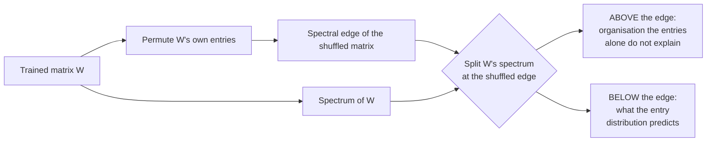
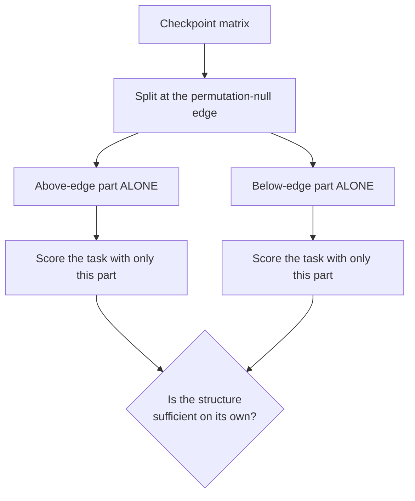
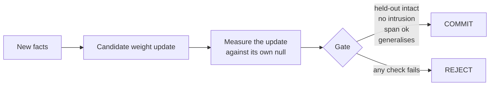

# Measuring organisation in trained weights: a permutation null, its validation, and three uses

**Working paper, 18 October 2026.** Companion to `docs/PAPER.md`. Numbers
regenerate from `results/structure/`, `results/grokking/`,
`results/live_learning/` and `results/capability/`.

---

## Abstract

We measure the organisation of a trained weight matrix against a null built
from the matrix itself: shuffle its own entries, take the resulting spectral
edge, and treat whatever sits above that edge as structure the entries alone
do not explain. The measure needs no task, no labels and no probes.

**It reads essentially zero on randomly initialised weights of identical
shape (σ = 0.000–0.006) and rises monotonically across trained models from
0.5B to 72B parameters (σ = 1.518 → 2.425).** It holds across four model
families at matched size. It does **not** demonstrably index capability: on
the four models where we also have a reasoning benchmark, σ and
log(parameters) rank-order accuracy identically, so the correlation cannot
separate them — and in the one comparison that does separate them, three
generations of 7B model, the weakest reads highest. That claim is withdrawn
in §2.1.

We then put it to three uses and report all three outcomes, including the
failure. **Detecting grokking: it works, 21 of 21 runs**, with a seed-matched
control in which five runs share every hyperparameter and differ only by seed
— the task-blind read fires in exactly the two that grokked. **Forecasting
grokking: it fails**, on all three preregistered tests, with a 0.77
false-positive rate in no-grokking controls. **Gating live learning: it
passes**, admitting a consolidated weight update only when the update
generalises and does not intrude on held-out knowledge.

The measure is therefore a detector of present organisation, not a predictor
of future behaviour. We state that distinction sharply because our own
earlier four-run version of this work claimed more, and the full sweep
withdrew it.

## 1. The measure

The null is the matrix's own entries, so the comparison holds the entry
distribution, the shape, and the scale fixed. Anything above the shuffled
edge is not explained by *what* the numbers are, only by *where* they are.
We report σ (count of singular values above the edge, in octaves), the mass
and fraction above it, and a tail exponent α.

Two properties make it usable as an instrument. It is **task-blind**: no
labels, no probe set, no forward passes. And it carries its own control —
every measurement comes with the null it was measured against.

## 2. Validation

The first question for any such measure is whether it reads zero when there
is nothing to find.

| model | params (B) | σ mean | σ max | mass above | α median |
|---|---|---|---|---|---|
| Qwen2.5-0.5B | 0.5 | 1.518 | 4 | 0.268 | 4.93 |
| Qwen2.5-1.5B | 1.5 | 1.724 | 4 | 0.247 | 4.92 |
| Qwen2.5-3B | 3 | 1.845 | 4 | 0.257 | 4.85 |
| Qwen2.5-7B | 7 | 1.959 | 5 | 0.237 | 4.82 |
| Qwen2.5-14B | 14 | 2.161 | 6 | 0.231 | 4.52 |
| Qwen2.5-32B | 32 | 2.176 | 6 | 0.320 | 3.98 |
| Qwen2.5-72B | 72 | **2.425** | 8 | 0.344 | 3.97 |
| *random init, 0.5B* | 0.5 | 0.006 | 1 | 0.0008 | 43.4 |
| *random init, 1.5B* | 1.5 | 0.000 | 0 | 0.0003 | 63.1 |
| *random init, 3B* | 3 | 0.000 | 0 | 0.0001 | 75.4 |
| *random init, 7B* | 7 | 0.000 | 0 | 0.0000 | 105.3 |
| *random init, 14B* | 14 | 0.000 | 0 | 0.0000 | 130.8 |
| *random init, 32B* | 32 | 0.000 | 0 | 0.0000 | 97.3 |

Randomly initialised weights of identical shape read zero. Trained weights of
the same shape read positive, and the reading rises with scale across two
orders of magnitude. The tail exponent separates the two regimes by more than
an order of magnitude (α ≈ 4 trained, 43–131 random).

**It is not family-specific.** At matched size: Mistral-7B-Instruct 2.045,
Llama-3.1-8B-Instruct 2.112, Gemma-2-9B-it 2.085, against Qwen2.5-7B's
1.959. Across generations of one family at fixed size: Qwen1.5-7B-Chat 2.259,
Qwen2-7B 1.934, Qwen2.5-7B 1.954.

### 2.1 Does it track capability? Not demonstrated, and one test says no

We also have a 132-item reasoning benchmark on four of these models:

| model | params | σ | α | benchmark accuracy |
|---|---|---|---|---|
| Qwen2.5-1.5B | 1.5 | 1.724 | 4.92 | 0.121 |
| Qwen2.5-7B | 7 | 1.959 | 4.82 | 0.606 |
| Gemma-2-9B-it | 9 | 2.085 | 4.41 | 0.894 |
| Qwen2.5-32B | 32 | 2.176 | 3.98 | 0.955 |

Spearman between σ and accuracy is +1.000 — and it is uninformative, because
on these four models σ, log(parameters) and accuracy **all rank-order
identically**:

| predictor | Spearman vs accuracy |
|---|---|
| σ | +1.000 |
| log(parameters) | +1.000 |
| σ vs log(parameters) | +1.000 |

With this sample the correlation cannot separate "σ tracks capability" from
"σ tracks size". We previously reported the Gemma row as separating them —
same size band as Qwen2.5-7B, higher on both σ and accuracy — but Gemma-2-9B
is the larger model, so it does not.

**The one comparison that does separate them points the other way.** Hold
parameter count fixed at 7B and vary capability by model generation:

| model | σ | α | relative capability |
|---|---|---|---|
| Qwen1.5-7B-Chat | **2.259** | **4.20** | weakest |
| Qwen2-7B-Instruct | 1.934 | 4.84 | middle |
| Qwen2.5-7B-Instruct | 1.959 | 4.82 | strongest |

The weakest of the three reads **highest** on σ and **lowest** on α, and both
of those indicate more structure. So where size is held constant and
capability genuinely varies, the measure runs backwards.

We therefore withdraw any claim that this measure indexes capability. What
the validation in §2 supports is narrower and still worth having: the read is
zero on untrained weights of identical shape, positive on trained ones, and
monotone in **parameter count** across two orders of magnitude and four model
families. Whether it also indexes capability is open, and the decisive test
is a benchmark run on Qwen1.5-7B against Qwen2.5-7B — same size, opposite σ,
known capability gap. That needs GPU access we do not currently have.

## 3. Use 1 — detecting grokking: 21 of 21

Grokking gives a rare thing: a known, unambiguous change in a network's
organisation, with a behavioural ground truth. We took a preregistered sweep
of 21 modular-arithmetic runs, read every saved checkpoint, and retrained
nothing.

| | runs | above-edge part alone | below-edge part alone |
|---|---|---|---|
| grokked | 15 | **0.99–1.00 in 15 of 15** | 0.01 |
| never grokked | 6 | **never above 0.08** | 0.01 |

The above-edge part alone performs the task; the below-edge part alone is at
chance. In runs that never grokked, no such sufficient part exists.

**The strongest evidence is a seed-matched control.** At weight decay 0.3,
five runs share identical hyperparameters and differ only by random seed; two
grokked (s1, s4) and three did not (s0, s2, s3). The task-blind read fired in
exactly the two that grokked. The measure is therefore not responding to
weight decay or to training length: hold the settings fixed, let the outcome
split by seed, and the reading follows the outcome.

**Two claims we withdrew.** An earlier four-run version of this analysis
reported that the above-edge part beats the whole model; across 15 runs that
happens in 1. It also reported that sufficiency arrives at the behavioural
jump; across 15 runs it coincides in 5 and arrives later in the rest, with a
median lag of 500 epochs — exactly the checkpoint spacing, so the true lag
may be smaller but is not resolvable at this sampling. Both withdrawals are
recorded in `docs/DESIGN_pregrok.md` with the original predictions left
untouched.

## 4. Use 2 — forecasting grokking: the claim fails

We preregistered three tests for whether structural reorganisation *leads*
the behavioural jump. All three failed.

| preregistered test | threshold | result |
|---|---|---|
| Lead | positive in ≥12 of 15, sign p<0.05 | best pair 10 of 13, p=0.046; **no Semataxy measure clears p=0.13** |
| Timing fit | Spearman(structural onset, behavioural onset) > 0.7 | best 0.79 among pairs with n≥12; most between −0.6 and 0.6 |
| Controls | onsets fire in <1 in 5 pairs in a no-grokking arm | **0.77 of pairs fire**; every one of the eight best leading pairs fires in 3 of 3 controls |

A fourth, unprimed comparison: spectral onsets arrive 0.3k–10k epochs *after*
the per-matrix Frobenius norm onset in most leading pairs. A norm — the
cheapest possible comparator — leads them.

**What the onset rule actually detects** is that weight matrices keep
reorganising after training accuracy reaches 1.0, which they do with or
without weight decay and whether or not generalisation ever arrives. This was
written into the design document as the alternative hypothesis before the
sweep ran, and it is what we found.

Restricted post hoc to the eight runs with a clean memorisation plateau,
nineteen measure pairs lead in 7 or 8 of 8 with median leads of 8k–23k
epochs. We report that because it may be where a future forecasting claim
lives, and we label it for what it is: a post-hoc subset, not a test.

## 5. Use 3 — gating live learning: it passes

If the measure identifies the organised part of an update, it can be used as
an admission criterion: accept a weight change into a model only when the
change is organised, generalises, and does not damage what was there.

On the v8 run the gate returns `heldout_ok`, `intrusion_ok`, `span_ok`,
`generalises` and `commit` all true, with a consolidated delta that is 99.97%
nonzero at L2 5.95 — i.e. it admits a genuinely distributed update rather
than a sparse patch. The arms compared are base, naive, compartment,
merged-untreated and consolidated, so a naive update and a compartmentalised
one are available as contrasts rather than assumed. Replicated across four
scales down to Pythia-160M.

## 6. What this half establishes, and what it does not

**Establishes.** A task-blind measure of organisation with a built-in null;
validated against random-init controls at six scales; monotone in scale
across two orders of magnitude; consistent across four model families; a
perfect rank ordering against a capability benchmark at n = 4; a detector of
grokking that holds 21 of 21 with a seed-matched control; and a working
admission gate for live weight updates.

**Does not establish.** That the measure forecasts anything — tested,
preregistered, failed, with a norm beating it. That σ predicts capability as
a quantity rather than a rank, which n = 4 cannot support. That any of this
explains *what* the organised subspace computes; sufficiency on a
modular-arithmetic task is not interpretation. And nothing here speaks to
whether the measure is the right notion of organisation, only that it is a
consistent and controlled one.

## 7. What it needs

1. **Capability at n = 11, not n = 4.** σ exists for eleven trained models;
   the benchmark has been run on four. This is pure compute on an existing
   instrument and would turn a rank ordering into a measurable relationship.
2. **A second ground truth besides grokking.** Grokking is the only
   unambiguous organisation change we have. Induction-head formation or a
   known circuit-formation event would be a second.
3. **Interpretation of the above-edge subspace.** Sufficiency says the
   structure is there; it does not say what it is.
4. **A forecasting rule that survives its controls**, or a clear statement
   that the measure is a detector only. On present evidence we say the
   latter.

Items 1 and 2 are compute-bound. Items 3 and 4 need design and independent
review. The gate tests currently extending this work to 3B, 7B and 14B are
queued on a cluster whose login nodes have been unreachable for several
hours, which is the immediate constraint rather than the interesting one.
