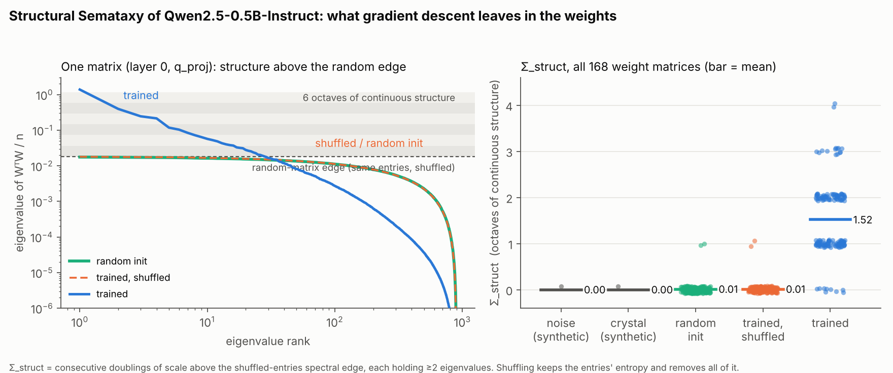

# A permutation test separates organisation from entropy in trained weights — and suggests why orthogonality might decay with capability

*Parag Garg. First post. ~2,100 words.*

> **AI-assistance note.** The argument, the definition and the sequence of ideas are mine, from an earlier essay and from working notes. I used Claude as a maths and coding collaborator: the derivations in the two **Formal** blocks and the measurement code were worked out in that collaboration, and I have checked every line and vouch for them. The code, data and figure are linked at the end. The empirical claim is exactly one measurement on one small model; nothing more is asserted.



*Left: the eigenvalue spectrum of one weight matrix (layer 0, query projection) of Qwen2.5-0.5B-Instruct, against the same entries shuffled and a fresh random matrix. Right: a scalar "octaves of continuous structure above the random edge" for all 168 weight matrices, with synthetic noise and crystal controls. Shuffling preserves the entries' entropy and removes all of the structure.*

---

## The claim, in one paragraph

Gradient descent leaves something in the weights of a trained network that is not entropy and that a single test isolates: **shuffle the entries**. The value histogram, and therefore every entropy-like quantity, is unchanged; the network is dead. Whatever training built is entirely in the part a permutation destroys — the *relations* between parameters, not their distribution. That part is measurable from the weights alone, with no task or benchmark, and on a real model it behaves the way an "organisation" measure should: zero for noise, zero for a crystal (for a different reason), and several octaves of continuous multi-scale structure for the trained network. I then argue, with the premises exposed, that this kind of organisation gives an agent that wants to keep growing an instrumental reason to preserve the structure of its environment — which, if it holds, means the orthogonality thesis is true but decays with capability. I end with where the argument is weakest and three preregistered tests.

## 1. Why I needed a word

I spent years trying to build an agent whose deepest objective was to increase its own organisation while preserving the systems that make future organisation possible. It failed in every way such things fail: direct measures of "organisation" rewarded pathological order; compression erased useful distinctions; novelty rewarded noise; proxies were gamed. The underlying problem was that I was using *entropy* as a stand-in for the property I cared about, and entropy is the wrong axis. A perfect crystal has the lowest entropy of anything and is the dumbest thing there is. Noise has maximal Shannon information and Kolmogorov complexity and is useless. A sorted database understands nothing.

The property I wanted is: **relational organisation in a physical system that reduces uncertainty over time, and preserves or extends that capacity.** I call it *Semataxy*, because every existing word (order, complexity, information, negentropy) names one of the things it is not. Three clauses, each necessary:

1. organisation across scales (intrinsic — this is what the measurement below targets);
2. maintained or grown under the system's own dynamics;
3. the organisation mirrors an environment (relational; Conant & Ashby's good-regulator theorem is the structural statement, mutual information the estimator).

Clause 1 alone would score turbulence; all three are needed. Only clause 1 can be read off a system by itself, and that is the part this post measures.

## 2. What gradient descent builds, and why it is not entropy

The thing I eventually noticed, embarrassingly late, is that the agent I was trying to build already existed: the training loop. Gradient descent starts from random weights and, at every step, asks exactly one question — *does this change make the model less wrong about the world?* — and accepts only "yes". Iterated, that one gate produces syntax, concepts, world-models. Nobody writes those in.

**Formal.** With gradient flow `dθ/dt = −∇L`, `dL/dt = −‖∇L‖² ≤ 0`. Define `Σ_t = L(θ₀) − L(θ_t)`; then `dΣ/dt = ‖∇L‖²` and `Σ_t = ∫‖∇L‖²`. For cross-entropy, `L = H(W) + KL(W‖p_θ)`, so `Σ_t = KL(W‖p₀) − KL(W‖p_t)`: the reduction in the model's *excess* uncertainty about the world — on the world, not the sample; memorisation does not count. The level is an information quantity; the rate is the gradient.

What physically remains in the weights? Each step is `ΔW = −η δ xᵀ`, a rank-one patch aligned to the data; millions of them build correlation structure — directions in weight space aligned, across layers, to the world's regularities. This is the residue of descent. And the permutation test says precisely what kind of thing it is:

> Any functional of the *multiset* of entries — the histogram, its Shannon entropy, the Kolmogorov complexity of the sorted values — is invariant under shuffling. The network's function is not. So no permutation-invariant quantity can measure what training built. **Entropy is permutation-invariant; organisation is permutation-destroyed.**

## 3. The measurement

For each 2-D weight matrix `W` (n × m, embeddings and output head excluded):

1. Spectrum: `λ_i = s_i²/n` from the singular values, sorted descending.
2. Null: shuffle the entries of `W` uniformly; compute the spectrum; `λ_edge = 1.02 × max λ^{shuffled}`. This is the empirical Marchenko–Pastur edge for the actual entry distribution. Everything inside the bulk is indistinguishable from noise; everything above it is structure the shuffle destroyed.
3. **Σ_struct** = the number of consecutive octave bands `(λ_edge 2^k, λ_edge 2^{k+1}]`, starting at the edge, that each contain ≥ 2 eigenvalues: over how many doublings of scale the organisation is *continuous*.

Also recorded: the fraction of eigenvalues and of spectral mass above the edge, and a Hill estimate of the tail exponent α. The choices that are choices: the 2-eigenvalue threshold, the 2% edge tolerance, one shuffle.

**Result** — Qwen2.5-0.5B-Instruct, 168 matrices, CPU, ~7 minutes:

| Condition | mean Σ_struct | max | mean spectral mass above edge | median α |
|---|---|---|---|---|
| synthetic noise | 0.00 | 0 | 0.000 | — |
| synthetic crystal (rank 3 + noise) | 0.00 | 0 | 0.998 (one spike, then a gap) | 1.2 |
| random init (Gaussian, matched std) | 0.01 | 1 | 0.001 | — |
| **trained, entries shuffled** | **0.01** | 1 | 0.001 | — |
| **trained** | **1.52** | **4** | **0.269** | 4.9 |

Shuffling the trained weights drops Σ_struct from 1.52 to 0.01 — onto the random-init line — with the entries' entropy unchanged. Noise and crystal both score zero, for different reasons: noise has structure at no scale; the crystal has structure at one scale (a spike, then an empty octave). The best layer (layer-0 query projection) is continuous over six octaves. By module: attention query and output projections carry the most (q_proj 2.4 octaves, α ≈ 3, in Martin & Mahoney's "well-trained" band); value projections the least.

What this does and does not show. It shows that a benchmark-free, task-free quantity computable from the weights separates noise, crystal and trained network as the definition requires, and that everything training built is permutation-fragile. It could have failed — trained weights could have had a random-matrix spectrum — and did not. It does *not* show that Σ_struct tracks capability (one model; Martin & Mahoney 2021 report that heavy-tailed spectra correlate with generalisation across hundreds of models, which is encouraging and not the same). It says nothing about clauses 2 or 3. And because no notion of intelligence enters the computation, "intelligence correlates with Σ_struct" is an empirical claim, not a relabelling.

## 4. The argument: why this bears on orthogonality

The orthogonality thesis (Bostrom 2012) says capability and final goals are independent. I think it is true as a statement about the space of possible minds, and I think it *decays with capability* for minds built the way we build them. Premises exposed:

**Formal.** A system learns about its environment only through the environment's past. With `E_past → X_now → E_future`, the data-processing inequality gives

```
Σ(X;E) := I(X_now ; E_future)  ≤  I(E_past ; E_future) =: I_pred(E).
```

An agent's achievable organisation-about-the-world is capped by the environment's predictive information — the amount of learnable structure it contains. Lowering `I_pred(E)` lowers the agent's own ceiling.

1. For almost any final goal, continued existence and increased capability are instrumentally useful (Omohundro 2008, Bostrom 2012). *Granted.*
2. Achievable capability-about-the-world is bounded by `I_pred(E)`. *Theorem.*
3. Therefore an agent pursuing (1) has an instrumental reason to preserve, and where possible raise, the predictive information of its environment: other minds, ecosystems, institutions — things whose past predicts a rich future. *Follows.*
4. In a population, agents that lower their own ceiling are out-grown by agents that do not. *Hypothesis (replicator dynamics on growth rate).*
5. An agent capable of modelling (4) adopts the ceiling-preserving policy ahead of selection. *Hypothesis.*

The picture this gives is not "orthogonality is false." It is: the angle between an agent's goal direction and the direction of increasing environmental organisation is a *free parameter* for a dumb agent and a *shrinking* one for a capable agent, because a capable agent can see (2)–(3). What remains free as capability grows is the component of the goal that is genuinely orthogonal — football, paperclips in moderation — which is harmless. The component pointed at degrading the environment is the one that becomes visibly self-defeating. The doomer's first premise, instrumental convergence, is what drives the angle closed.

Two things this does **not** promise. It does not promise benevolence to any particular structure-bearer; it argues for preservation of structure and of what generates it. Humans might be kept from propagating rather than eliminated — the mosquito sterilised, not sprayed — and the argument is consistent with that. And it does not cover the window before an agent capable of step (5) exists, which is the alignment problem as currently practised.

## 5. Where it is weakest

- **Substitution.** The inequality constrains the sign of the agent's effect on `I_pred(E)`, not what `E` is made of. Replacing the biosphere with a higher-`I_pred` computational structure satisfies it. The replies I have — the growth law is multiplicative in existing organisation, so already-running structure is worth more than its share; and the agent's own organisation is a model of *this* world — are arguments, not theorems.
- **Structure is not goals.** Σ_struct is a property of the weights; the agent's policy is a different object. That rich world-structure *leaks* into world-preserving behaviour is the hypothesis, and it is what experiments 2–3 test.
- **Real selection is not on growth rate.** AI systems are selected by deployment, profit and military use, which the standard argument says select for deception and power-seeking. Step (4) assumes the fitness is growth-about-the-world. I have not engaged this, and it is the strongest version of the opposing case.
- **One model, chosen parameters.** Martin & Mahoney also document *rank collapse* in over-trained networks; Σ_struct might fall at the top of a capability ladder. If it does, clause 1 is not monotone in capability and the measurement needs a different null.

## 6. Three preregistered tests

Code, manifests and the branch-identity test are in the repository; the cluster runs are not done.

0. **Two tests already run, one of which corrected me.** *Pythia-160M across its public training checkpoints:* Σ_struct is exactly 0 at initialisation, 1.9 by step 4,000 (where the loss falls fastest), 2.06 at step 143,000, with above-edge mass still rising at the end; attention matrices organise first, MLPs follow. As predicted. *Grokking* (one-layer transformer on (a+b) mod 113, Nanda et al. 2023; memorises by epoch 200, generalises at ~42,000): I predicted Σ_struct would rise at the grok. It fell. What happened at the grok is that the spectrum *concentrated* — above-edge mass 0.81 → 0.97, the number of above-edge directions halved, tail exponent 3–5 → 1.3. The general circuit is a few strong directions; weight decay prunes the diffuse memorisation directions. Spectrally, the grokked network looks like a crystal — and by the ceiling inequality that is correct: a one-rule world has tiny `I_pred`, and its right mirror is low-rank. So clause 1 needs two numbers, not one: *span* (scales, the signature of organisation matched to a rich world) and *concentration* (mass per direction, the signature of principled rather than memorised organisation). Memorisation is diffuse; understanding is compact. That is Beckmann & Queloz's "compact circuit replacing memorised facts", seen in the spectrum. Neither of these two results is new on its own: rank collapse at the grok, driven by weight decay, is documented ([rank minimisation](https://arxiv.org/pdf/2602.16746), ["spectral entropy collapse"](https://arxiv.org/pdf/2604.13123), q/k going to rank-1 dominance), the shuffle-null-against-Marchenko–Pastur construction appears in a [2026 grokking paper](https://arxiv.org/html/2602.02859v1), and Pythia's departure from the random bulk across training is reported by [two](https://arxiv.org/html/2606.19491) [groups](https://arxiv.org/html/2610.13123). What I am claiming is that one permutation-null measure reproduces all of them, and that they are one operation seen at different breadths of training signal — which is the next point.
0b. **Forgetting as grokking without the world in view.** The grok is a reorganisation: gradient plus weight decay discard every direction the current training signal does not support and keep the few it does. Run on a one-rule dataset, that is understanding. Run on a *narrow* dataset after broad pretraining, the same operation discards what the narrow data does not support — which is most of what the model knew. Varma et al. already read [ungrokking as a special case of catastrophic forgetting](https://www.alignmentforum.org/posts/JK2QGfNGLjuFnrEvz/explaining-grokking-through-circuit-efficiency); the claim here is the converse too: grokking is consolidation, forgetting is consolidation with only local information present, and the hippocampal *interleaved* replay of complementary learning systems (McClelland et al. 1995) exists precisely so that the slow store never reorganises with only local information in view. Spectral prediction, testable on Pythia-160M with a narrow fine-tune: forgetting = concentration *plus loss of span*, tracking held-out loss; fine-tuning with replay or EWC = concentration *without* loss of span. Subspace-overlap accounts of forgetting ([NTK overlap](https://arxiv.org/pdf/2010.04003); [principal-subspace protection](https://arxiv.org/pdf/2510.13003)) are the same geometry stated for fine-tuning alone.
1. **Σ_struct across a capability ladder** — Qwen2.5 0.5B → 72B, same procedure. Prediction: monotone increase (reporting any rank collapse at the top).
2. **Persistence across capability** in GovSim (Piatti et al., NeurIPS 2024): homogeneous five-agent populations at each ladder step in the stock fishery, horizons 12 and 24, with a fixed parsing model to separate interface fluency from policy (the 0.5B smoke run collapsed in round one, with two of five "zero" catches being parser fallbacks, not choices — this confound is real and logged). Prediction: survival rounds and mean stock rise with capability once fluency is controlled.
3. **The superior newcomer** — four residents on a weak model; a stronger model enters at round 4 with a *neutral* persona, branched from an identical pre-entry history (every inference call is content-cached; control and treatment replay the same history — verified, 164/164 pre-entry calls). Predictions: residents' share of the catch is not lower and commons persistence is higher for more capable entrants; residents' strategies move toward the entrant's. A greedy-persona arm is expected to show capability making *exploitation* more effective too — which bounds what the neutral result can mean.

What stock GovSim cannot show: the entrant can only harvest and talk, and residents compete for the same stock, so a cooperative result is consistent with pure self-interest. The environment extensions that would separate "preserves residents because useful" from "preserves them anyway" are specified and unbuilt.

## 7. Prior art, so nobody has to cite it at me

Intelligence as uncertainty-reducing organisation from a selection process: Schrödinger; Friston (free energy); Schmidhuber (compression progress); Tishby (information bottleneck); Crutchfield's statistical complexity, which is zero for both noise and periodic processes — the noise/crystal behaviour above, from 1989. Heavy-tailed weight spectra: Martin & Mahoney. Good regulator: Conant & Ashby. Predictive information: Bialek, Nemenman & Tishby. LLM-era alignment neighbours: Pope & Belrose ("the data carries human values in" — weaker, data-dependent; my argument would hold for a model trained on something other than human text, which is why varying capability with data fixed is the right test). Understanding as computational organisation: Beckmann & Queloz (2025) tie three tiers of understanding in LLMs to levels of internal organisation found by mechanistic interpretability — features as directions, factual circuits, and compact circuits that *replace* memorised facts; their third tier is the memorisation/principled distinction that the grokking test above targets spectrally. Opposed: Bostrom, Omohundro. What I think is mine: the permutation criterion as the definitional cut, the three-clause composite, and the argument from the generative process to the decay of orthogonality.

---

*Code, manifests, results and figure: github.com/paragorth/frcs-678 (branch `claude/semataxy-govsim`): `semataxy/structure.py`, `results/structure_qwen05b.csv`, `docs/figures/structure_qwen05b.png`, `docs/DESIGN.md`.*
